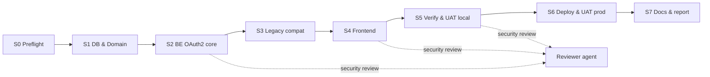

# Workflow — OAuth2 Social Login Implementation

Each step ends with a **Gate**. Do not start the next step until the gate passes and `docs/implementation/oauth2/STATUS.md` is updated.



---

## S0 — Preflight (PLAN T0.x)
1. Verify env keys exist without printing values:
   ```powershell
   Select-String taskpilot\.env -Pattern '^(GOOGLE_OAUTH|GITHUB_OAUTH|OAUTH2_)' | % { ($_.Line -split '=')[0] }
   ```
2. Clean working tree on both repos; branch `feat/oauth2-social-login` from latest `main`.
3. Find the next Flyway version on the target branch (`db/migration/V*__*.sql`, take max+1). Record it in STATUS.md.
4. Read `DECISIONS.md` fully.

**Gate S0**: env 5/5 set · branches clean · Flyway version recorded.

## S1 — Database & Domain (T1.x)
1. Forward-only migration: `password_hash DROP NOT NULL`; `user_identities` (`id`, `user_id` FK ON DELETE CASCADE, `provider`, `provider_subject`, `email`, `created_at`, `last_login_at`, `UNIQUE(provider, provider_subject)`, index `user_id`).
2. Entity/enum/repository in `taskpilot-users/.../common/`.

**Gate S1**: app boots on dev DB; existing users unchanged; TC-BE-DB-01/02 pass.

## S2 — Backend OAuth2 core (T2.x)
Order matters: properties → conditional registrations → cookie repo → mappers → account service → one-time code store → handlers → SecurityConfig → controller endpoints.

**Gate S2**:
- TC-BE-MAP, ACC, OTC, HDL, CK, SEC, CFG, INT pass.
- Manual: `GET http://localhost:8080/oauth2/authorization/google` → reaches Google consent; after consent BE redirects to `http://localhost:5173/auth/callback?code=…`.
- Reviewer agent: checklist §A–§D.

## S3 — Legacy compatibility (T3.x)
**Gate S3**: TC-BE-REG-01..03 pass; full backend reactor `./mvnw clean verify` BUILD SUCCESS.

## S4 — Frontend (T4.x)
1. Service + store → `SocialLoginButtons` → Login/Register → `AuthCallbackPage` + route `/auth/callback` (public route, outside auth guard) → Profile → i18n.
2. Apply `anti-ai-ui` while building, not after.

**Gate S4**: TC-FE-01..07 pass; `npm run build && npm run lint` pass; end-to-end local login works for Google and GitHub; reviewer checklist §E.

## S5 — Verification & UAT local (T5.x)
1. `npx playwright test e2e/09-oauth2-callback.spec.ts`.
2. Skills: `i18n-checker`, `anti-ai-ui`, `mobile-responsive-test`.
3. Run UAT.md cases (Local column), save screenshots to `report/src/assets/auth-oauth2/`.

**Gate S5**: all Must AC verifiable locally are PASS; secret scan empty.

## S6 — Deploy & UAT prod (T6.x)
1. `hf-deploy-verifier` skill (Java 25 build, Docker, port 7860, env).
2. Deploy BE (HF) then FE (Netlify).
3. UAT Prod column, especially U-13 (`redirect_uri` https + HF host) and U-14.

**Gate S6**: AC-13 PASS; no `redirect_uri_mismatch`; HF logs clean of secrets.

## S7 — Docs & report (T8.x)
1. Finalize STATUS.md (metrics, AC evidence, log).
2. Progress tracker: period log + `PROGRESS_INDEX.md` (replace Authentik wording in Đợt 06 with Spring Security OAuth2).
3. Replace `report/src/chapter2/authentik.typ` content with Spring Security OAuth2 / OIDC; add sequence diagram `sequence-auth-oauth2-social-login.mmd`.

**Gate S7**: DoD in PLAN.md §6 fully ticked.

---

## Rollback
- FE: hide social block (providers endpoint returns empty when both client IDs are blank) → unset `GOOGLE_OAUTH_CLIENT_ID` and `GITHUB_OAUTH_CLIENT_ID` on HF and restart. Email/password login unaffected.
- DB: migration is additive; `password_hash` nullable is backward-compatible. Do not drop `user_identities` in prod without a backup.
