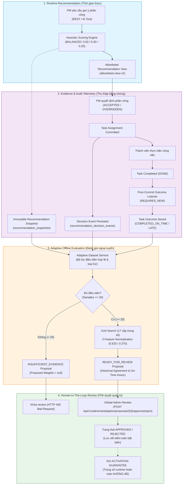
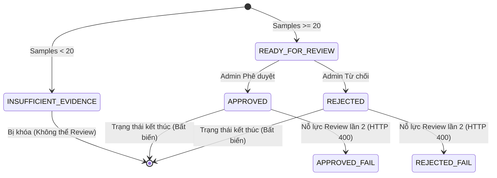

# Hướng dẫn Adaptive MVP — TaskPilot (Adaptive MVP Guide)

---

## Mục lục
- [1. Tóm tắt điều hành](#1-tóm-tắt-điều-hành)
- [2. Bài toán cần giải quyết](#2-bài-toán-cần-giải-quyết)
- [3. Những gì hệ thống đã có trước Adaptive](#3-những-gì-hệ-thống-đã-có-trước-adaptive)
- [4. Kiến trúc end-to-end](#4-kiến-trúc-end-to-end)
- [5. Giải thích từng phase](#5-giải-thích-từng-phase)
- [6. Dataset lấy từ đâu?](#6-dataset-lấy-từ-đâu)
- [7. Một evidence chain hoàn chỉnh](#7-một-evidence-chain-hoàn-chỉnh)
- [8. Eligibility và exclusion](#8-eligibility-và-exclusion)
- [9. Minimum evidence gate](#9-minimum-evidence-gate)
- [10. Two-feature normalization](#10-two-feature-normalization)
- [11. Shadow proposal algorithm](#11-shadow-proposal-algorithm)
- [12. Proposal lifecycle](#12-proposal-lifecycle)
- [13. Human-in-the-loop và no activation](#13-human-in-the-loop-và-no-activation)
- [14. Cách chứng minh Adaptive phản ứng với dữ liệu](#14-cách-chứng-minh-adaptive-phản-ứng-với-dữ-liệu)
- [15. Security and authorization](#15-security-and-authorization)
- [16. Current verification status](#16-current-verification-status)
- [17. Limitations and future work](#17-limitations-and-future-work)
- [18. Definition of Done](#18-definition-of-done)
- [19. Kịch bản thuyết trình 5–7 phút](#19-kịch-bản-thuyết-trình-57-phút)
- [20. Câu hỏi phản biện thường gặp](#20-câu-hỏi-phản-biện-thường-gặp)

---

## 1. Tóm tắt điều hành

TaskPilot ghi lại chuỗi bằng chứng bất biến gồm: snapshot gợi ý phân công (`recommendation_snapshots`), quyết định chọn/ghi đè của Project Manager (`recommendation_decision_events`), và kết quả hoàn thành công việc thực tế (`recommendation_task_outcomes`). Từ các bằng chứng hợp lệ, hệ thống tái cấu trúc một dataset tất định để thực hiện đánh giá offline (shadow evaluation) và đề xuất bộ trọng số mới cho Admin xem xét.

Quy trình phê duyệt (`APPROVED`) chỉ ghi nhận kết quả đánh giá của quản trị viên và lưu vết kiểm toán bất biến. Hệ thống **tuyệt đối không tự động kích hoạt** (No-Activation Guarantee) hay thay đổi trọng số heuristic đang chạy trên môi trường thực tế.

---

## 2. Bài toán cần giải quyết

Trong các hệ thống phân công công việc dựa trên heuristic đa tiêu chí (AHP-inspired), trọng số thường được cố định tĩnh (ví dụ: Fit = 0.50, Load = 0.30, Performance = 0.20) dựa trên nhận định ban đầu.

Hạn chế của cách tiếp cận này:
1. **Thiếu khả năng thích ứng**: Trọng số tĩnh không phản ánh được văn hóa làm việc thực tế của từng dự án hoặc xu hướng ưu tiên của các Project Manager (PM).
2. **Nguy cơ điều chỉnh cảm tính**: Nếu thay đổi trọng số mà không có dữ liệu đối sánh, hệ thống có thể gây xáo trộn chất lượng phân công hoặc thiên lệch nguy hiểm.
3. **Nguy cơ từ dữ liệu thiếu sót**: Trong môi trường thực tế, nếu dữ liệu chưa đo lường được (ví dụ: Workload chưa đo, Performance mặc định) mà bị hệ thống xem là "kém" hoặc "thất bại", việc học tự động sẽ gây sai lệch nghiêm trọng.
4. **Yêu cầu bằng chứng bất biến**: Mọi suy luận tối ưu hóa cần được truy nguyên từ dữ liệu lịch sử không thể chỉnh sửa, đảm bảo tính giải trình và an toàn tuyệt đối.

---

## 3. Những gì hệ thống đã có trước Adaptive

Trước khi bước vào giai đoạn Adaptive MVP, TaskPilot đã hoàn thiện nền tảng tính điểm heuristic (Phase 1) với các đặc tính:
- **Skill Fit ($F$)**: Đo lường thực tế (`fitStatus = MEASURED`) từ mức độ trùng khớp kỹ năng yêu cầu của task và hồ sơ kỹ năng của thành viên.
- **Workload ($L$)**: Đo lường số lượng công việc đang thực hiện trong phạm vi dự án (`workloadUnit = "ACTIVE_TASK_COUNT"`, `workloadScope = "PROJECT"`, `workloadStatus = MEASURED`).
- **Performance ($P$)**: Chưa có chu kỳ đánh giá hiệu suất định kỳ; hệ thống gán mặc định baseline an toàn (`performanceStatus = DEFAULT`, giá trị $0.50$). Do đó, tiêu chí Performance bị loại trừ khỏi không gian tối ưu hóa Adaptive.
- **Chiến lược Heuristic**: Ba chế độ định sẵn (`BALANCED`, `URGENT`, `TRAINING`).
- **Xếp hạng tất định**: Sử dụng ranking key số nguyên dấu phẩy tĩnh $10^9$ kết hợp tie-break theo raw Skill Fit và `userId`, loại bỏ triệt để sai số làm tròn hiển thị.

---

## 4. Kiến trúc end-to-end

Kiến trúc luồng xử lý từ lúc tạo gợi ý đến khi phê duyệt đề xuất trọng số được phân tách rõ ràng thành 4 ranh giới:



---

## 5. Giải thích từng phase

### Phase 1: Heuristic Correctness & Presentation Boundary
- **Vấn đề**: Sai lệch chuẩn hóa equal-range ($max \le min$), sụp đổ thứ tự do làm tròn hiển thị 2 chữ số thập phân, rò rỉ trường nội bộ trong payload JSON.
- **Giải pháp**: Chuẩn hóa trung tính (`normalizeNeutral`), comparator số nguyên $10^9$, DTO allowlist (`RecommendationView`), phân biệt trạng thái dữ liệu (`MEASURED`, `DEFAULT`, `UNVERIFIED`).
- **Trạng thái**: `IMPLEMENTED_AND_AUTOMATED_VERIFIED`.

### Phase 2A: Recommendation Snapshot Foundation
- **Vấn đề**: Không lưu lại trạng thái điểm số và dữ liệu đầu vào tại thời điểm đưa ra gợi ý, khiến việc đối soát sau này là bất khả thi.
- **Giải pháp**: Flyway `V34__create_recommendation_snapshots_tables.sql`, entity `RecommendationSnapshotEntity` và `RecommendationSnapshotCandidateEntity` lưu giữ toàn bộ dữ liệu ứng viên, trọng số, phiên bản mô hình (`scoringModelVersion = "relative-neutral-fixed-point-v2"`, `presentationContractVersion = "allowlisted-view-v2"`).
- **Trạng thái**: `IMPLEMENTED_AND_AUTOMATED_VERIFIED`.

### Phase 2B: PM Decision Events
- **Vấn đề**: Không biết PM chấp nhận (`ACCEPTED`) hay chọn người khác (`OVERRIDDEN`), hoặc phân công thủ công mà không thông qua gợi ý (`UNOBSERVED`).
- **Giải pháp**: Flyway `V35__create_recommendation_decision_events_table.sql`, entity `RecommendationDecisionEventEntity`. Ràng buộc duy nhất `UNIQUE (snapshot_id)` đảm bảo mỗi snapshot có tối đa một quyết định gắn liền. Phân công task phải commit thành công trước khi ghi nhận event.
- **Trạng thái**: `IMPLEMENTED_AND_AUTOMATED_VERIFIED`.

### Phase 2C: Measured Active Task Count Workload
- **Vấn đề**: Workload trước đây là số nhập tay tĩnh, không có dấu thời gian và không gắn với dự án thực tế.
- **Giải pháp**: Flyway `V36__add_phase_2c_measured_workload_to_snapshots.sql`. Không tạo bảng workload riêng; thay vào đó, hệ thống thực hiện batch aggregation query `TaskRepository.countActiveAssignedTasksByProject(projectId, terminalStatuses)` (loại trừ `TaskStatus.DONE`) thông qua `ProjectMemberPort` / `ProjectModuleAdapter`. DTO hợp đồng `WorkloadMeasurement` chuẩn hóa đơn vị `ACTIVE_TASK_COUNT`, phạm vi `PROJECT`, trạng thái `MEASURED` kèm `workloadMeasuredAt` (hoặc fallback `UNVERIFIED`). Bảng `recommendation_snapshot_candidates` được bổ sung 3 cột (`workload_unit`, `workload_scope`, `workload_measured_at`) và bảng `tasks` được tối ưu với index `idx_tasks_project_assignee_status`.
- **Trạng thái**: `IMPLEMENTED_AND_AUTOMATED_VERIFIED`.

### Phase 2D: Task Completion Outcomes
- **Vấn đề**: Thiếu bằng chứng thực tế về việc phân công có đem lại kết quả hoàn thành đúng hạn hay không.
- **Giải pháp**: Flyway `V37__create_recommendation_task_outcomes.sql`. Bổ sung cột `completed_at` vào bảng `tasks` kèm index `idx_tasks_completed_at`. Tạo bảng `recommendation_task_outcomes` với ràng buộc duy nhất `CONSTRAINT uk_task_outcomes_decision_task UNIQUE ("decision_id", "task_id")`. Listener `@TransactionalEventListener(phase = AFTER_COMMIT)` kích hoạt lưu trữ độc lập (`REQUIRES_NEW`) khi task chuyển sang `DONE`. Phân loại `COMPLETED_ON_TIME` ($completedAt \le dueAt$) hoặc `COMPLETED_LATE` ($completedAt > dueAt$).
- **Trạng thái**: `IMPLEMENTED_AND_AUTOMATED_VERIFIED`.

> **Nhóm Telemetry**: Bốn thành phần Phase 2A, 2B, 2C, 2D cấu thành **Phase 2A–2D Evidence Pipeline**, đảm bảo chuỗi dữ liệu đầu vào cho Adaptive hoàn toàn có thể kiểm toán và truy nguyên.

### Phase 2E: Adaptive Dataset Builder & Quality Reporting
- **Vấn đề**: Dữ liệu nằm rải rác trên nhiều bảng, có nguy cơ lẫn lộn dữ liệu rác, thiếu dấu vết toàn vẹn.
- **Giải pháp**: `AdaptiveDatasetService` liên kết các bảng trong pipeline bằng chứng, áp dụng hơn 20 lý do loại trừ (`AdaptiveExclusionReason`), tạo báo cáo chất lượng `AdaptiveDatasetQualityReportDto` và mã hóa SHA-256 canonical dataset (`dataset_version = "dataset-v1"`).
- **Trạng thái**: `IMPLEMENTED_AND_AUTOMATED_VERIFIED`.

### Phase 2F: Offline Adaptive Weight Proposals & Admin Lifecycle
- **Vấn đề**: Cần thuật toán tìm kiếm trọng số tối ưu dựa trên dữ liệu mà không làm gián đoạn hệ thống đang chạy.
- **Giải pháp**: Flyway `V38__create_adaptive_weight_proposals.sql` và `V39__correct_adaptive_proposal_safety.sql`, entity `AdaptiveWeightProposalEntity`, service `AdaptiveWeightProposalService`, controller `AdaptiveAdminController` (`/api/v1/admin/ai/adaptive/**`). Chuẩn hóa baseline 2 chiều (0.625 / 0.375), grid search 17 bước (`algorithm_version = "grid-search-v1"`, `proposal_version = "proposal-v1"`), tie-break tất định 5 cấp độ, cổng kiểm tra tính toàn vẹn, bảo vệ No-Activation Guarantee.
- **Trạng thái**: `IMPLEMENTED_AND_AUTOMATED_VERIFIED` (UAT thực tế và kiểm tra restart persistence trên PostgreSQL local đang chờ môi trường daemon).

---

## 6. Dataset lấy từ đâu?

Dataset huấn luyện/đánh giá Adaptive **không phải là file CSV bên ngoài**, mà được tái cấu trúc hoàn toàn từ cơ sở dữ liệu vận hành của TaskPilot thông qua chuỗi liên kết 4 thực thể:

```text
recommendation_snapshots (Snapshot lúc gọi gợi ý)
   │
   ├── recommendation_snapshot_candidates (Danh sách ứng viên & điểm số lúc đó)
   │
recommendation_decision_events (Quyết định của PM gắn với snapshotId & taskId)
   │
recommendation_task_outcomes (Kết quả hoàn thành công việc gắn với decisionId & taskId)
   │
tasks (Kiểm tra người thực nhận nhiệm vụ có đúng selectedCandidateId không)
```

> **Lưu ý quan trọng**: Một công việc được tạo thủ công rồi bấm hoàn thành `DONE` đơn thuần sẽ **không bao giờ** đủ điều kiện trở thành mẫu dữ liệu Adaptive, bởi vì nó thiếu snapshot ban đầu và thiếu quyết định của PM (`UNOBSERVED`).

---

## 7. Một evidence chain hoàn chỉnh

Ví dụ mẫu dữ liệu tổng hợp hợp lệ:

| Bước | Thực thể | Dữ liệu mẫu | Ý nghĩa |
| :--- | :--- | :--- | :--- |
| 1. Snapshot | `rec-snap-001` | Candidate A: Fit=0.85, Load=2 (`ACTIVE_TASK_COUNT`)<br/>Candidate B: Fit=0.75, Load=0 (`ACTIVE_TASK_COUNT`) | Hệ thống xếp hạng Candidate A đứng top 1 (`rank = 1`). |
| 2. Quyết định | `rec-dec-001` | `decisionType = ACCEPTED`, `decisionSource = USER`<br/>`selectedCandidateId = Candidate A` | PM chấp nhận khuyến nghị của hệ thống và chọn A. |
| 3. Giao task | `tasks` | `assigneeId = Candidate A` | Task được phân công thực tế cho Candidate A. |
| 4. Hoàn thành | `rec-out-001` | `dueAt = 17:00`, `completedAt = 16:30`<br/>`outcomeType = COMPLETED_ON_TIME` | Công việc hoàn thành đúng tiến độ. |
| 5. Đánh giá | `AdaptiveDatasetService` | **ELIGIBLE** (Hợp lệ đưa vào Dataset) | Chuỗi liên kết hoàn chỉnh, dữ liệu đo lường đầy đủ. |

---

## 8. Eligibility và exclusion

### Tiêu chí hợp lệ (Eligibility Criteria)
1. **Snapshot**: Sử dụng hợp đồng hiển thị `allowlisted-view-v2`, trạng thái phân hóa khác `UNOBSERVED`.
2. **Ứng viên**: Tiêu chí Fit có trạng thái `MEASURED` và giá trị hợp lệ trong $[0.0, 1.0]$. Tiêu chí Workload có trạng thái `MEASURED`, đơn vị `ACTIVE_TASK_COUNT`, phạm vi `PROJECT`, có dấu thời gian đo lường. Tiêu chí Performance mang tính mặc định bị loại trừ.
3. **Quyết định**: Nguồn quyết định là `USER`, loại quyết định là `ACCEPTED` hoặc `OVERRIDDEN`. Người được chọn phải khớp với người nhận task cuối cùng.
4. **Kết quả**: Loại kết quả là `COMPLETED_ON_TIME` hoặc `COMPLETED_LATE`. Khớp chính xác `projectId` và `taskId`. Không bị trùng lặp.

### Phân loại lý do loại trừ (Exclusion Reasons từ mã nguồn)
Khi mẫu không thỏa mãn, hệ thống ghi nhận chính xác mã lý do vào báo cáo chất lượng:
- `OUTCOME_EXCLUDED`: Task outcome bị đánh dấu loại trừ (do thiếu deadline hoặc thời gian hoàn thành).
- `OUTCOME_NOT_COMPLETED`: Task chưa hoàn thành (`INCOMPLETE_OVERDUE`, `NOT_YET_OBSERVABLE`).
- `DECISION_NOT_FOUND`: Không tìm thấy bản ghi quyết định tương ứng với outcome.
- `NON_USER_DECISION`: Quyết định tự động bởi hệ thống (`SYSTEM`), ví dụ task hết hạn.
- `NON_ASSIGNMENT_DECISION`: Quyết định từ chối/hủy bỏ (`REJECTED`, `CANCELED`, `EXPIRED`).
- `DECISION_TASK_MISMATCH`: Quyết định có `taskId` không khớp với outcome.
- `SNAPSHOT_NOT_FOUND`: Không tìm thấy snapshot liên kết với quyết định.
- `SNAPSHOT_UNOBSERVED`: Snapshot mang trạng thái phân công ngoài luồng khuyến nghị.
- `SNAPSHOT_VERSION_UNSUPPORTED`: Phiên bản hợp đồng snapshot cũ không tương thích.
- `SNAPSHOT_TASK_MISMATCH`: Snapshot không khớp `taskId`.
- `SELECTED_CANDIDATE_NOT_IN_SNAPSHOT`: Ứng viên PM chọn không nằm trong danh sách snapshot.
- `CANDIDATE_FIT_NOT_MEASURED`: Điểm Skill Fit không đo lường được (`INSUFFICIENT_DATA`).
- `CANDIDATE_WORKLOAD_NOT_MEASURED`: Điểm Workload chưa đo lường (`UNVERIFIED`).
- `CANDIDATE_WORKLOAD_UNIT_UNSUPPORTED`: Đơn vị workload không phải `ACTIVE_TASK_COUNT`.
- `CANDIDATE_WORKLOAD_SCOPE_UNSUPPORTED`: Phạm vi workload không phải `PROJECT`.
- `CANDIDATE_WORKLOAD_TIMESTAMP_MISSING`: Workload thiếu dấu thời gian đo lường.
- `ASSIGNEE_MISMATCH`: Người thực nhận task trong bảng `tasks` khác với người PM chọn.
- `AMBIGUOUS_LINKAGE`: Tồn tại nhiều quyết định hoặc outcome trùng lặp cho cùng một task.
- `UNSUPPORTED_HEURISTIC_MODE`: Snapshot có `heuristicMode` khác `BALANCED` (ví dụ `URGENT`, `TRAINING`) hoặc `null`. Adaptive MVP giới hạn phạm vi chặt chẽ vào chiến lược `BALANCED` để bảo toàn Strategy Pattern. Mỗi dòng dữ liệu trong dataset (`AdaptiveDatasetRowDto`) đều bảo lưu rõ ràng trường `heuristicMode`.

---

## 9. Minimum evidence gate

Để tránh hiện tượng "học vẹt" (overfitting) trên tập dữ liệu quá nhỏ, hệ thống áp đặt **Ngưỡng bằng chứng tối thiểu là 20 mẫu hợp lệ**:

```text
Số mẫu hợp lệ < 20:
  ├── Status: INSUFFICIENT_EVIDENCE
  ├── Proposed Weights: null
  ├── Proposed Metrics: null
  ├── Current Normalized Baseline: (0.625, 0.375)
  ├── Dataset Hash: Có sẵn (SHA-256)
  └── Admin Review: BỊ KHÓA (Nỗ lực duyệt/từ chối đều nhận HTTP 400 Bad Request)

Số mẫu hợp lệ >= 20:
  ├── Status: READY_FOR_REVIEW
  ├── Proposed Weights: Được tính toán từ Grid Search ([0.10, 0.90])
  ├── Proposed Metrics: Có đầy đủ (historicalAgreement, onTimeAssociation)
  └── Admin Review: MỞ (Admin có thể Approve hoặc Reject)
```

---

## 10. Two-feature normalization

Trong môi trường runtime, hệ thống dùng 3 trọng số:
$$w_{fit} = 0.50, \quad w_{load} = 0.30, \quad w_{perf} = 0.20 \quad (\sum = 1.0)$$

Vì `performance` luôn là mặc định $0.50$, không gian Adaptive chỉ tối ưu hóa 2 đặc trưng: Skill Fit và Workload. Để so sánh công bằng giữa trọng số đề xuất mới và trọng số hiện tại, hệ thống thực hiện chuẩn hóa baseline:

$$\text{denominator} = w_{fit} + w_{load} = 0.50 + 0.30 = 0.80$$
$$\text{currentAdaptiveFit} = \frac{0.50}{0.80} = 0.625$$
$$\text{currentAdaptiveLoad} = \frac{0.30}{0.80} = 0.375$$

**Nguồn gốc trọng số baseline**:
Trọng số baseline không bị hardcode trong mã nguồn Java mà được nạp động từ cấu hình runtime thông qua `HeuristicStrategyFactory.resolve("BALANCED")` (truy vấn `system_settings["heuristic.weights"]` qua `HeuristicConfigProvider`).

**Tính chất bất biến**:
$$\text{currentAdaptiveFit} + \text{currentAdaptiveLoad} = 0.625 + 0.375 \equiv 1.0$$
Trọng số runtime của hệ thống vẫn được giữ nguyên $0.50 / 0.30 / 0.20$.

---

## 11. Shadow proposal algorithm

Khi có $\ge 20$ mẫu hợp lệ, thuật toán dò lưới tĩnh (Grid Search) sẽ duyệt qua 17 cặp trọng số khả thi:
- $w_{fit} \in [0.10, 0.90]$ với bước nhảy `gridStep = 0.05`.
- $w_{load} = 1.0 - w_{fit}$.

Với mỗi cặp trọng số, thuật toán mô phỏng lại việc xếp hạng các ứng viên trong từng snapshot của dataset, xác định người đứng top 1 theo comparator chuẩn $10^9$.

### Hệ thống Tie-Break 5 cấp độ
1. **Historical Agreement**: Tỷ lệ ứng viên mô phỏng top 1 trùng khớp với lựa chọn thực tế của PM (càng cao càng tốt).
2. **On-Time Association**: Tỷ lệ ứng viên mô phỏng top 1 trùng khớp với lựa chọn của PM trong các task hoàn thành đúng hạn (`COMPLETED_ON_TIME`).
3. **Weight Delta**: Khoảng cách Manhattan nhỏ nhất tới baseline chuẩn hóa:
   $$\Delta = |w_{fit} - 0.625| + |w_{load} - 0.375|$$
4. **Higher Fit Weight**: Ưu tiên trọng số Skill Fit cao hơn.
5. **Stable Index**: Chọn chỉ số ứng viên nhỏ hơn trong lưới.

*Lưu ý*: Các chỉ số đánh giá thể hiện **mức độ tương đồng lịch sử** (historical association), không phải là chứng minh quan hệ nhân quả (causal proof) rằng trọng số mới sẽ làm tăng hiệu suất.

---

## 12. Proposal lifecycle

Vòng đời của một bản ghi đề xuất trọng số tuân thủ máy trạng thái nghiêm ngặt:



### Tính bất biến của trường dữ liệu
- Khi chuyển sang `APPROVED` hoặc `REJECTED`, chỉ các trường: `status`, `reviewedByUserId`, `reviewedAt`, `reviewNotes` / `rejectionReason` được cập nhật.
- Tất cả các trường dữ liệu lõi (`datasetHash`, `datasetSampleCount`, `proposedFitWeight`, `proposedLoadWeight`, `currentAdaptiveFitWeight`, v.v.) được giữ nguyên vẹn 100%.

---

## 13. Human-in-the-loop và no activation

Một điểm then chốt của Adaptive MVP là **sự tách biệt hoàn toàn giữa Proposal được duyệt và Trọng số đang chạy**:

| Khái niệm | Ý nghĩa | Vị trí lưu trữ | Tác động runtime |
| :--- | :--- | :--- | :--- |
| **APPROVED Proposal** | Admin đồng ý với kết quả phân tích offline của hệ thống | Bảng `adaptive_weight_proposals` | **KHÔNG CÓ TÁC ĐỘNG NÀO** |
| **ACTIVE Production Weights** | Trọng số đang được nạp vào bộ nhớ để tính điểm gợi ý | `system_settings` / `HeuristicConfigProvider` | Quyết định thứ tự hiển thị ứng viên |

### Danh sách các yếu tố KHÔNG ĐỔI sau khi bấm Approve
1. Trọng số chế độ `BALANCED` (vẫn là 0.50 / 0.30 / 0.20).
2. Trọng số chế độ `URGENT` và `TRAINING`.
3. Điểm số heuristic của từng ứng viên khi gọi API `/api/v1/ai/auto-assign`.
4. Thứ tự xếp hạng của danh sách ứng viên trả về trên giao diện.

---

## 14. Cách chứng minh Adaptive phản ứng với dữ liệu

Để kiểm chứng rằng thuật toán thực sự nhạy với dữ liệu lịch sử chứ không trả về kết quả ngẫu nhiên:

### Kịch bản 1: Dataset A (Thiên hướng Skill Fit)
- **Đặc điểm dữ liệu**: Trong 20 mẫu, PM liên tục chọn ứng viên có Skill Fit vượt trội (dù Workload của họ cao). Các task này đều hoàn thành đúng hạn.
- **Kỳ vọng toán học**:
  $$proposedFitWeight > 0.625 \quad (\text{ví dụ: } 0.70 \text{ hoặc } 0.75)$$

### Kịch bản 2: Dataset B (Thiên hướng Workload)
- **Đặc điểm dữ liệu**: Trong 20 mẫu, PM liên tục chọn ứng viên đang rảnh rỗi (Workload thấp) dù Skill Fit chỉ ở mức trung bình. Các task này đều hoàn thành đúng hạn.
- **Kỳ vọng toán học**:
  $$proposedLoadWeight > 0.375 \quad (\text{hoặc } proposedLoadWeight > proposedFitWeight)$$

### Tình trạng kiểm chứng thực tế trong mã nguồn (Sensitivity Proof Status)
- **Thiên hướng Workload**: `IMPLEMENTED_AND_AUTOMATED_VERIFIED`. Bài test `test03_tieBreakLevel1_highestAgreement` trong `AdaptiveWeightProposalTest.java` đã được củng cố assertion tường minh:
  ```java
  assertEquals(WeightProposalStatus.READY_FOR_REVIEW, proposal.status());
  assertTrue(proposal.proposedLoadWeight() > proposal.proposedFitWeight());
  assertTrue(proposal.proposedLoadWeight() > proposal.currentAdaptiveLoadWeight()); // 0.55 > 0.375
  assertTrue(proposal.proposedFitWeight() < proposal.currentAdaptiveFitWeight());   // 0.45 < 0.625
  assertEquals(0.45, proposal.proposedFitWeight(), 1e-4);
  assertEquals(0.55, proposal.proposedLoadWeight(), 1e-4);
  assertEquals(1.0, proposal.proposedFitWeight() + proposal.proposedLoadWeight(), 1e-4);
  ```
- **Thiên hướng Skill Fit**: `IMPLEMENTED_AND_AUTOMATED_VERIFIED`. Bài test `test09_fitDominantEvidence_movesProposalTowardFit` trong `AdaptiveWeightProposalTest.java` kiểm chứng tập dữ liệu 20 mẫu thiên Fit:
  ```java
  assertEquals(WeightProposalStatus.READY_FOR_REVIEW, proposal.status());
  assertTrue(proposal.proposedFitWeight() > proposal.currentAdaptiveFitWeight());   // 0.75 > 0.625
  assertTrue(proposal.proposedLoadWeight() < proposal.currentAdaptiveLoadWeight()); // 0.25 < 0.375
  assertTrue(proposal.proposedFitWeight() > proposal.proposedLoadWeight());
  assertEquals(0.75, proposal.proposedFitWeight(), 1e-4);
  assertEquals(0.25, proposal.proposedLoadWeight(), 1e-4);
  assertEquals(1.0, proposal.proposedFitWeight() + proposal.proposedLoadWeight(), 1e-4);
  ```
- **Bằng chứng đối sánh chéo (Cross-Dataset Proof)**: `IMPLEMENTED_AND_AUTOMATED_VERIFIED`. Bài test `test10_crossDatasetProof_distinctEvidenceProducesOpposingProposals` chứng minh:
  1. Mã băm canonical dataset của 2 tập dữ liệu là khác biệt (`assertNotEquals(fitHash, loadHash)`).
  2. Trọng số đề xuất là khác biệt (`assertNotEquals(fitPropWeights, loadPropWeights)`).
  3. Chiều dịch chuyển đối nghịch nhau so với baseline chuẩn hóa $(0.625, 0.375)$.
  4. Cả hai đều thỏa mãn cận an toàn $[0.10, 0.90]$ và tổng đơn vị $1.0$.

### Giới hạn của dữ liệu kiểm thử tổng hợp (Synthetic Data Limitations)
> [!IMPORTANT]
> Các bài kiểm thử độ nhạy tổng hợp (Synthetic sensitivity tests) chứng minh thuật toán và mã nguồn **phản ứng đúng hướng toán học** với các bằng chứng được kiểm soát.
>
> Chúng **tuyệt đối không chứng minh**:
> - Mối quan hệ nhân quả (Causal improvement) hay tốc độ giao việc thực tế sẽ tăng;
> - Hiệu quả vận hành sản xuất thực tế (Production effectiveness);
> - Hiệu suất làm việc hay tính công bằng của nhân viên;
> - Tính hữu ích trên dữ liệu tổ chức thực tế;
> - Độ ổn định của mô hình trong tương lai.
>
> Việc tích lũy bằng chứng thực tế ($\ge 20$ chuỗi dữ liệu thật) và kiểm thử UAT trực tiếp trên PostgreSQL local độc lập vẫn là hai cổng nghiệm thu riêng biệt bắt buộc.

---

## 15. Security and authorization

1. **Phân quyền Admin toàn cục**: Toàn bộ endpoint tại `/api/v1/admin/ai/adaptive/**` (hoặc `/api/admin/ai/adaptive/**`) yêu cầu quyền `ROLE_ADMIN` hoặc `ADMIN`. Người dùng thường nhận HTTP 403 Forbidden, người chưa đăng nhập nhận HTTP 401 Unauthorized.
2. **Ngữ cảnh xác thực (Security Context)**: ID của người thực hiện (`reviewedByUserId`, `created_by_user_id`) được trích xuất trực tiếp từ email của token đăng nhập thông qua `UserIdentityPort.findByEmail(...)`. Hệ thống tuyệt đối không nhận `userId` từ body request để chống mạo danh.
3. **An toàn dữ liệu**: Không trả về mật khẩu, token, thông tin nhạy cảm hay email cá nhân trong các DTO phản hồi.
4. **Cấm sửa SQL trực tiếp**: Không cho phép can thiệp cập nhật trạng thái proposal bằng câu lệnh SQL ngoài luồng; mọi chuyển đổi trạng thái phải đi qua API để được validate tính toàn vẹn.

---

## 16. Current verification status

| Thành phần | Trạng thái kỹ thuật | Bằng chứng kiểm thử / Chi tiết |
| :--- | :--- | :--- |
| Chuẩn hóa Heuristic Phase 1 | `IMPLEMENTED_AND_AUTOMATED_VERIFIED` | 30 focused unit tests pass 100% (`ScoreRangeTest`, `HeuristicStrategyTest`, v.v.) |
| Snapshot Telemetry (Phase 2A) | `IMPLEMENTED_AND_AUTOMATED_VERIFIED` | 16 tests pass (`RecommendationSnapshotTest`) |
| PM Decisions (Phase 2B) | `IMPLEMENTED_AND_AUTOMATED_VERIFIED` | 33 tests pass (`RecommendationDecisionTest`, ràng buộc `UNIQUE(snapshot_id)`) |
| Workload Telemetry (Phase 2C) | `IMPLEMENTED_AND_AUTOMATED_VERIFIED` | 12 tests pass (`MeasuredWorkloadActiveTaskCountTest`) + 2 tests pass (`ProjectModuleAdapterTest`) |
| Task Completion Outcomes (Phase 2D) | `IMPLEMENTED_AND_AUTOMATED_VERIFIED` | 34 tests pass (`RecommendationTaskOutcomeTest`, ràng buộc `uk_task_outcomes_decision_task`) |
| Dataset Builder (Phase 2E) | `IMPLEMENTED_AND_AUTOMATED_VERIFIED` | 24 tests pass (`AdaptiveDatasetBuilderTest`, bao gồm kiểm chứng loại trừ chế độ non-BALANCED) |
| Shadow Proposals & Lifecycle (Phase 2F) | `IMPLEMENTED_AND_AUTOMATED_VERIFIED` | 25 unit tests pass (`AdaptiveWeightProposalTest` [11], `AdaptiveWeightProposalLifecycleTest` [14], bao gồm kiểm chứng baseline động và an toàn legacy proposal) |
| Kịch bản UAT tổng hợp tự động | `IMPLEMENTED_AND_AUTOMATED_VERIFIED` | 6 tests pass (`AdaptiveMvpUatTest`) — **Lưu ý**: đây là automated synthetic scenario verification, không phải live UAT |
| Bằng chứng độ nhạy 2 chiều (Sensitivity Proof) | `IMPLEMENTED_AND_AUTOMATED_VERIFIED` | Đã kiểm chứng tự động bằng synthetic proof: Workload-dominant (`test03`: 0.55 > 0.375), Fit-dominant (`test09`: 0.75 > 0.625), và Cross-dataset proof (`test10`) |
| Bền vững khi khởi động lại (Restart Persistence) | `IMPLEMENTED_LIVE_UAT_PENDING` | JPA mappings and Flyway V38/V39/V40 migration source are implemented and statically reconciled. V40 adds nullable `target_heuristic_mode` with check constraint without synthetic backfill; legacy proposals remain non-reviewable. Actual migration execution, Hibernate schema validation, proposal persistence, and restart retrieval against isolated PostgreSQL remain NOT YET VERIFIED. |
| Live UAT trên PostgreSQL local | `IMPLEMENTED_LIVE_UAT_PENDING` | Daemon local port 5432 chưa mở; cấm kết nối Supabase từ xa |
| Dữ liệu sản xuất thực tế | `IMPLEMENTED_REAL_DATA_INSUFFICIENT` | Cần thời gian vận hành dự án thật để tích lũy đủ $\ge 20$ mẫu |

> [!NOTE]
> **Phân định rõ ràng về số lượng kiểm thử (Test Accounting)**:
> - **Các bộ test tập trung đã tài liệu hóa (Documented Focused Suites)**: Tất cả đều vượt qua với 0 thất bại và 0 lỗi:
>   - Phase 0 Focused Heuristic: 30 tests
>   - Phase 2A, 2B, 2D Evidence Pipeline: 83 tests (Snapshot: 16, Decision: 33, Outcome: 34)
>   - Phase 2C Workload Active Task Count: 14 tests (MeasuredWorkload: 12, Adapter: 2)
>   - Phase 2E–2F Adaptive Focused: 55 tests (Dataset Builder: 24, Proposal Algorithm: 11, Proposal Lifecycle: 14, Synthetic UAT: 6)
>   - Tổng số test trong các suite tập trung: **182 tests** ($30 + 83 + 14 + 55 = 182$) (không đại diện cho toàn bộ regression).
> - **Toàn bộ bộ hồi quy (Full taskpilot-ai regression)**:
>   - **425 discovered**
>   - **412 passed**
>   - **13 skipped** (các integration test cần cơ sở dữ liệu thật hoặc cấu hình mở rộng)
>   - **0 failures**
>   - **0 errors**

---

## 17. Limitations and future work

### Giới hạn MVP hiện tại
- Chưa có tính năng tự động áp dụng trọng số (thiết kế an toàn chủ đích).
- Phạm vi Adaptive MVP giới hạn chặt chẽ trong chế độ `BALANCED`; các chế độ `URGENT` và `TRAINING` bị loại trừ khỏi dataset.
- Tiêu chí Performance chưa tham gia vào quá trình tối ưu.
- Chưa có giao diện web Admin riêng cho Adaptive.
- Yêu cầu cứng 20 mẫu hợp lệ.

### Nợ kỹ thuật đã ghi nhận (Technical Debt)
- `TD-P2D-OUTCOME-PERSISTENCE-AFTER-TASK-COMPLETION`: Chưa có Transactional Outbox; nếu ghi outcome lỗi thì không làm rollback task hoàn thành.
- `TD-P2D-REOPEN-HISTORY`: Task mở lại và hoàn thành lần 2 vẫn giữ nguyên bản ghi outcome của lần hoàn thành đầu tiên.

### Định hướng các giai đoạn sau
- Cơ chế kích hoạt có kiểm soát (Canary release cho trọng số mới).
- Mở rộng thích ứng đa chiến lược (Multi-strategy adaptation cho `URGENT` và `TRAINING`).
- Cơ chế tự động hoàn nguyên (Automatic Rollback) nếu tỷ lệ trễ hạn tăng.
- Đưa chu kỳ đánh giá hiệu suất (Performance evaluation cycle) vào hệ thống.

---

## 18. Definition of Done

Checklist hoàn tất Adaptive MVP:
- [x] Toàn bộ documented focused suites (182 tests: 30 + 83 + 14 + 55) pass sạch sẽ không lỗi; full taskpilot-ai regression suite đạt 425 discovered, 412 passed, 13 skipped, 0 failures, 0 errors.
- [x] Bằng chứng độ nhạy tổng hợp 2 chiều (Fit-dominant và Workload-dominant) được kiểm chứng tự động.
- [x] Giới hạn phạm vi Adaptive MVP vào chế độ `BALANCED` (`targetHeuristicMode = BALANCED`), bảo lưu `heuristicMode` trong dataset row, loại trừ snapshot non-`BALANCED`.
- [x] Script Flyway V38, V39 và migration forward V40 được tạo chuẩn xác, bất biến.
- [x] Dưới 20 mẫu trả về `INSUFFICIENT_EVIDENCE`, trọng số `null`, khóa review.
- [x] Đủ 20 mẫu trả về `READY_FOR_REVIEW`, trọng số trong $[0.10, 0.90]$.
- [x] Phân loại đủ 20+ lý do loại trừ mẫu dữ liệu không hợp lệ.
- [x] Phân quyền Admin toàn cục chặt chẽ (chặn 403, 401).
- [x] Cơ chế No-Activation Guarantee được chứng minh (trọng số active giữ nguyên).
- [x] Báo cáo Decision H-024 được cập nhật.
- [ ] Chạy kiểm thử UAT trực tiếp trên PostgreSQL local độc lập (đang chờ môi trường).

---

## 19. Kịch bản thuyết trình 5–7 phút

```text
[0:00 - 0:45] Mở đầu & Vấn đề
"Kính thưa thầy cô và hội đồng, trong các hệ thống phân công công việc thông minh, việc dùng trọng số cố định thường gặp phải bài toán: văn hóa mỗi dự án là khác nhau. Có dự án coi trọng kỹ năng chuyên môn, có dự án lại ưu tiên giải phóng tải công việc. Nếu thay đổi trọng số bằng cảm tính, hệ thống sẽ thiếu căn cứ và tiềm ẩn rủi ro lớn."

[0:45 - 2:00] Giải pháp Telemetry 4 giai đoạn
"Thay vì áp dụng thuật toán phức tạp ngay từ đầu, TaskPilot chọn cách tiếp cận an toàn: xây dựng chuỗi bằng chứng bất biến.
- Khi gợi ý: hệ thống chụp ảnh snapshot toàn bộ điểm số ứng viên lúc đó.
- Khi PM chọn: ghi nhận quyết định PM chấp nhận hay ghi đè.
- Khi làm xong: lắng nghe sự kiện hoàn thành để xác định công việc có đúng hạn hay trễ hạn.
Bốn mắt xích này tạo thành một chuỗi dữ liệu có nguồn gốc rõ ràng, không thể làm giả."

[2:00 - 3:30] Bộ lọc Dataset & Thuật toán Đề xuất Shadow
"Từ dữ liệu đó, Adaptive Dataset Service áp dụng hơn 20 bộ lọc nghiêm ngặt để loại bỏ các dữ liệu rác hoặc thiếu chuẩn. Đặc biệt, hệ thống giới hạn chặt chẽ vào chế độ BALANCED để bảo toàn Strategy Pattern, và đặt ra Ngưỡng bằng chứng tối thiểu là 20 mẫu. Nếu dưới 20 mẫu, hệ thống từ chối đưa ra phỏng đoán để chống học vẹt.
Khi đủ 20 mẫu, thuật toán Offline Grid Search sẽ duyệt 17 bộ trọng số khả thi trong ngưỡng an toàn từ 0.10 đến 0.90, tìm ra bộ trọng số có độ tương đồng lịch sử cao nhất với quyết định của PM."

[3:30 - 4:45] An toàn tuyệt đối: Human-in-the-loop & No-Activation
"Điểm quan trọng nhất về mặt an toàn kỹ thuật: Đề xuất này chỉ dành cho Admin xem xét. Khi Admin bấm Approve, hệ thống chỉ lưu vết phê duyệt vào sổ kiểm toán. Trọng số đang chạy trên production hoàn toàn KHÔNG bị thay đổi. Điều này đảm bảo hệ thống không bao giờ tự ý hành động ngoài tầm kiểm soát của con người."

[4:45 - 6:00] Kết quả kiểm thử & Định hướng
"Hiện tại, toàn bộ logic đã được bao phủ bởi các bộ test tự động tập trung (178 tests) và toàn bộ regression suite đạt 423 discovered, 410 passed, 13 skipped, 0 failures, 0 errors. Thuật toán đã được kiểm chứng phản ứng nhạy với cả dữ liệu thiên Fit và thiên Workload. Bước tiếp theo khi đưa vào vận hành thực tế sẽ là thu thập đủ 20 mẫu dữ liệu thật để đánh giá trước khi tính đến chuyện kích hoạt trọng số. Em xin cảm ơn thầy cô."
```

---

## 20. Câu hỏi phản biện thường gặp

### 1. Thuật toán Adaptive nằm ở đâu trong mã nguồn?
Nằm hoàn toàn ở module `taskpilot-ai`, cụ thể tại package `com.taskpilot.ai.service` (`AdaptiveDatasetService`, `AdaptiveWeightProposalService`) và `com.taskpilot.ai.controller` (`AdaptiveAdminController`).

### 2. Đây có phải là mô hình Machine Learning phức tạp (như Deep Learning / Reinforcement Learning) không?
Không. Đây là phương pháp **Offline Heuristic Policy Evaluation** thông qua tìm kiếm lưới có ràng buộc (Bounded Grid Search) kết hợp tie-break tất định. Cách tiếp cận này có ưu điểm vượt trội về tính minh bạch, có thể giải thích 100% công thức và không có rủi ro "hộp đen".

### 3. Dataset lấy từ đâu? Có thể import file Excel/CSV vào không?
Không import ngoài. Dataset được tái cấu trúc nội bộ từ 4 bảng dữ liệu vận hành: `recommendation_snapshots`, `recommendation_snapshot_candidates`, `recommendation_decision_events`, và `recommendation_task_outcomes`.

### 4. Vì sao cần ngưỡng 20 mẫu hợp lệ?
Để ngăn chặn hiện tượng đề xuất trọng số lệch lạc do cỡ mẫu quá nhỏ (vấn đề sample efficiency và overfitting). Dưới 20 mẫu, hệ thống trả về `INSUFFICIENT_EVIDENCE` và khóa tính năng phê duyệt.

### 5. Vì sao tiêu chí Performance bị loại khỏi Adaptive?
Vì hiện tại tiêu chí Performance trong hệ thống đang dùng giá trị mặc định $0.50$ (chưa có chu kỳ đánh giá hiệu suất định kỳ). Đưa một biến số tĩnh vào tối ưu hóa sẽ làm sai lệch kết quả.

### 6. Vì sao Admin bấm Approve mà trọng số vẫn không đổi?
Đây là nguyên tắc an toàn **No-Activation Guarantee**. Phê duyệt chỉ mang ý nghĩa nghiệm thu kết quả phân tích dữ liệu ngoại tuyến. Việc kích hoạt trọng số thật đòi hỏi giai đoạn sau với cơ chế Canary release và Rollback tự động.

### 7. Làm sao chứng minh thuật toán thực sự nhạy với dữ liệu?
Thuật toán Grid Search và tie-break 5 cấp độ đã được kiểm chứng tự động toàn diện trong `AdaptiveWeightProposalTest.java`:
- `test03` kiểm chứng thiên Workload: khi PM ưu tiên ứng viên rảnh rỗi, đề xuất dịch chuyển tăng $w_{load}$ vượt baseline ($0.55 > 0.375$) và giảm $w_{fit}$ ($0.45 < 0.625$).
- `test09` kiểm chứng thiên Skill Fit: khi PM ưu tiên ứng viên kỹ năng cao, đề xuất dịch chuyển tăng $w_{fit}$ vượt baseline ($0.75 > 0.625$) và giảm $w_{load}$ ($0.25 < 0.375$).
- `test10` kiểm chứng đối sánh chéo: 2 tập dữ liệu sinh ra 2 mã băm SHA-256 khác nhau, 2 bộ trọng số khác nhau, và dịch chuyển theo 2 hướng đối nghịch.
*Lưu ý*: Kiểm thử dữ liệu tổng hợp chứng minh tính đúng đắn về thuật toán và toán học, nhưng không chứng minh quan hệ nhân quả hay cải thiện hiệu suất trên dữ liệu tổ chức thực tế.

### 8. Nếu PM cố tình chọn sai ứng viên thì sao?
Thuật toán có tiêu chí tie-break cấp 2: `onTimeAssociation`. Hệ thống chỉ đánh giá cao những lựa chọn của PM mà công việc thực tế sau đó **hoàn thành đúng hạn**. Nếu PM chọn sai người dẫn tới trễ hạn, lựa chọn đó sẽ không giúp cặp trọng số tương ứng giành chiến thắng.

### 9. Nếu task bị Reopen thì kết quả thế nào?
Theo nợ kỹ thuật `TD-P2D-REOPEN-HISTORY`, hệ thống bảo toàn kết quả của lần hoàn thành đầu tiên để ghi nhận việc đáp ứng cam kết ban đầu, không ghi đè dữ liệu.

### 10. Khi nào hệ thống mới đủ điều kiện chạy Production thật?
Hệ thống cần: (1) Hoàn thành UAT trên cơ sở dữ liệu PostgreSQL thực tế, (2) Tích lũy đủ $\ge 20$ chuỗi dữ liệu thật qua quá trình sử dụng của người dùng, (3) Triển khai cơ chế kích hoạt có giám sát (Canary) ở giai đoạn tiếp theo.
