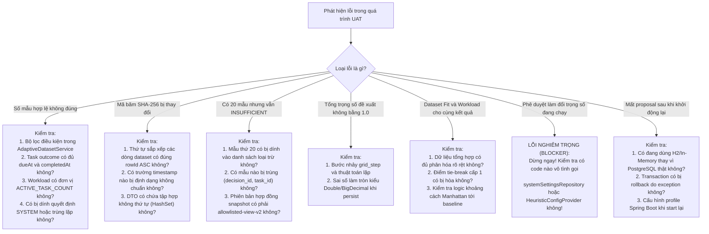

# Sổ tay quy trình kiểm thử nghiệm thu Adaptive MVP (Adaptive MVP Verification Runbook)

---

## Mục lục
- [1. Quy tắc an toàn bắt buộc (Safety Rules)](#1-quy-tắc-an-toàn-bắt-buộc-safety-rules)
- [2. Cổng kiểm tra môi trường (Environment Gate)](#2-cổng-kiểm-tra-môi-trường-environment-gate)
- [3. Biên dịch và kiểm thử tự động (Build and Automated Tests)](#3-biên-dịch-và-kiểm-thử-tự-động-build-and-automated-tests)
- [4. Kiểm tra an toàn thông tin định danh và artifact (Credential and Artifact Check)](#4-kiểm-tra-an-toàn-thông-tin-định-danh-và-artifact-credential-and-artifact-check)
- [5. Thiết lập và kiểm tra Migration (Migration Setup and Validation)](#5-thiết-lập-và-kiểm-tra-migration-migration-setup-and-validation)
- [6. Cơ chế nạp dữ liệu bằng chứng được phê duyệt (Approved Evidence Setup)](#6-cơ-chế-nạp-dữ-liệu-bằng-chứng-được-phê-duyệt-approved-evidence-setup)
- [7. Kịch bản A: 19 mẫu hợp lệ (Scenario A: 19 Eligible Samples)](#7-kịch-bản-a-19-mẫu-hợp-lệ-scenario-a-19-eligible-samples)
- [8. Kịch bản B: Mẫu thứ 20 đạt ngưỡng (Scenario B: Twentieth Sample)](#8-kịch-bản-b-mẫu-thứ-20-đạt-ngưỡng-scenario-b-twentieth-sample)
- [9. Kịch bản C: Báo cáo loại trừ mẫu rác (Scenario C: Exclusion Report)](#9-kịch-bản-c-báo-cáo-loại-trừ-mẫu-rác-scenario-c-exclusion-report)
- [10. Kịch bản D: Độ nhạy thiên hướng Skill Fit (Scenario D: Fit-dominant Sensitivity)](#10-kịch-bản-d-độ-nhạy-thiên-hướng-skill-fit-scenario-d-fit-dominant-sensitivity)
- [11. Kịch bản E: Độ nhạy thiên hướng Workload (Scenario E: Workload-dominant Sensitivity)](#11-kịch-bản-e-độ-nhạy-thiên-hướng-workload-scenario-e-workload-dominant-sensitivity)
- [12. Kịch bản F: Phân quyền truy cập (Scenario F: Authorization)](#12-kịch-bản-f-phân-quyền-truy-cập-scenario-f-authorization)
- [13. Kịch bản G: Phê duyệt đề xuất và bảo vệ No-Activation (Scenario G: Approval)](#13-kịch-bản-g-phê-duyệt-đề-xuất-và-bảo-vệ-no-activation-scenario-g-approval)
- [14. Kịch bản H: Từ chối đề xuất (Scenario H: Rejection)](#14-kịch-bản-h-từ-chối-đề-xuất-scenario-h-rejection)
- [15. Kịch bản I: Tính bền vững khi khởi động lại (Scenario I: Restart Persistence)](#15-kịch-bản-i-tính-bền-vững-khi-khởi-động-lại-scenario-i-restart-persistence)
- [16. Cây chẩn đoán lỗi (Failure Diagnostic Tree)](#16-cây-chẩn-đoán-lỗi-failure-diagnostic-tree)
- [17. Biểu mẫu thu thập bằng chứng UAT (Evidence Capture Template)](#17-biểu-mẫu-thu-thập-bằng-chứng-uat-evidence-capture-template)
- [18. Tiêu chuẩn đánh giá nghiệm thu (Acceptance Statuses)](#18-tiêu-chuẩn-đánh-giá-nghiệm-thu-acceptance-statuses)

---

## 1. Quy tắc an toàn bắt buộc (Safety Rules)

1. **Chỉ dùng PostgreSQL Local**: Chỉ cho phép chạy kiểm thử trên PostgreSQL nội bộ chạy tại `<LOCAL_DB_HOST>` (`localhost` hoặc `127.0.0.1`).
2. **Cơ sở dữ liệu dùng một lần (Disposable UAT DB)**: Phải tạo database riêng biệt `<UAT_DB_NAME>` cho mục đích UAT, không dùng chung database chính.
3. **Tuyệt đối không kết nối Cloud / Supabase**: Nghiêm cấm trỏ cấu hình UAT tới pooler Supabase hoặc cơ sở dữ liệu production.
4. **Không dùng dữ liệu thật**: Không sử dụng thông tin định danh, tên người dùng thật, email thật hay dữ liệu dự án thực tế.
5. **Cấm sửa đổi database bằng SQL trực tiếp**: Không được dùng câu lệnh `INSERT`, `UPDATE`, `DELETE` thủ công để ép trạng thái proposal hay tạo dữ liệu giả; toàn bộ luồng phải chạy qua API/service nghiệp vụ của ứng dụng.
6. **Không in thông tin nhạy cảm**: Không ghi mật khẩu, JWT, connection string đầy đủ hay secret key vào log hoặc tài liệu báo cáo.
7. **Bảo vệ No-Activation**: Nghiêm cấm mọi hành vi kích hoạt tự động trọng số vào cấu hình runtime đang chạy.

---

## 2. Cổng kiểm tra môi trường (Environment Gate)

Trước khi thực hiện bất kỳ bước kiểm thử nào, kiểm tra nghiêm ngặt các điều kiện tiên quyết sau:

```bash
# 1. Kiểm tra máy chủ cơ sở dữ liệu
Test-NetConnection -ComputerName <LOCAL_DB_HOST> -Port 5432

# 2. Kiểm tra Git branch và commit SHA
git rev-parse --show-toplevel
git branch --show-current
git rev-parse HEAD
# Xác nhận commit SHA phải là <COMMIT_SHA> (ví dụ: 7f2181a hoặc mới hơn)

# 3. Kiểm tra trạng thái Git sạch sẽ
git status --short
# Kết quả phải rỗng hoặc chỉ chứa file tài liệu không ảnh hưởng mã nguồn
```

> **Cảnh báo dừng khẩn cấp (STOP UAT)**: Nếu cổng 5432 trên `<LOCAL_DB_HOST>` bị đóng, hoặc nếu cấu hình database trỏ tới tên miền bên ngoài (ví dụ Supabase), hoặc nếu commit SHA không khớp với bản đã xác minh mã nguồn: **DỪNG KIỂM THỬ NGAY LẬP TỨC** và báo cáo trạng thái `BLOCKED_ENVIRONMENT`.

---

## 3. Biên dịch và kiểm thử tự động (Build and Automated Tests)

### Mục đích
Xác nhận toàn bộ mã nguồn của 7 module trong reactor biên dịch thành công, các bộ test tập trung vượt qua với 0 thất bại và 0 lỗi, và bộ hồi quy đầy đủ đạt chỉ số kiểm thử chính xác.

### Lệnh thực thi

```powershell
# Di chuyển tới thư mục gốc của backend
cd D:\HK6-UIT\DA1\taskpilot

# 1. Biên dịch kiểm thử toàn bộ reactor (7 modules)
.\mvnw.cmd test-compile -Dmaven.compiler.useIncrementalCompilation=false

# 2. Chạy bài kiểm thử đề xuất trọng số tập trung (Bao gồm kiểm chứng độ nhạy 2 chiều)
.\mvnw.cmd test -pl taskpilot-ai -am -o "-Dtest=AdaptiveWeightProposalTest" "-Dsurefire.failIfNoSpecifiedTests=false" "-Dmaven.compiler.useIncrementalCompilation=false"

# 3. Chạy toàn bộ suite Adaptive tập trung (55 tests)
.\mvnw.cmd test -pl taskpilot-ai -am -o "-Dtest=*AdaptiveDataset*Test,*WeightProposal*Test,*Adaptive*Mvp*Test" "-Dsurefire.failIfNoSpecifiedTests=false" "-Dmaven.compiler.useIncrementalCompilation=false"

# 4. Chạy kiểm thử Heuristic Phase 0 (30 tests)
pwsh -NoProfile -File ".agents\skills\taskpilot-heuristic-correctness\scripts\run-focused-tests.ps1"

# 5. Chạy pipeline bằng chứng Phase 2A–2D (95 tests)
.\mvnw.cmd test -pl taskpilot-ai -am -o "-Dtest=RecommendationSnapshotTest,RecommendationDecisionTest,MeasuredWorkloadActiveTaskCountTest,RecommendationTaskOutcomeTest" "-Dsurefire.failIfNoSpecifiedTests=false" "-Dmaven.compiler.useIncrementalCompilation=false"

# 6. Chạy kiểm thử hồi quy đầy đủ (Full taskpilot-ai regression)
.\mvnw.cmd test -pl taskpilot-ai -o "-Dmaven.compiler.useIncrementalCompilation=false"
```

### Kết quả kỳ vọng
- **Các bộ kiểm thử tập trung (Documented Focused Suites)**:
  - Phase 0 Focused Heuristic: **30 bài** (`Failures = 0`, `Errors = 0`, `Skipped = 0`).
  - Phase 2A, 2B, 2D Evidence Pipeline: **83 bài** (`Failures = 0`, `Errors = 0`, `Skipped = 0`).
  - Phase 2C Workload Active Task Count: **14 bài** (MeasuredWorkload: 12, Adapter: 2).
  - Phase 2E–2F Adaptive Focused Suite: **55 bài** (`Failures = 0`, `Errors = 0`, `Skipped = 0` across Dataset Builder: 24, Proposal Algorithm: 11, Proposal Lifecycle: 14, Synthetic UAT: 6).
  - *Tổng số bài kiểm thử tập trung*: **182 bài** ($30 + 83 + 14 + 55 = 182$) vượt qua sạch sẽ (0 thất bại, 0 lỗi).
  - *Lưu ý*: Các tổng số bài kiểm thử tập trung này không đại diện cho toàn bộ bộ kiểm thử hồi quy `taskpilot-ai`.
- **Toàn bộ bộ kiểm thử hồi quy (Full taskpilot-ai regression)**:
  - **425 discovered**
  - **412 passed**
  - **13 skipped** (các kiểm thử integration yêu cầu cơ sở dữ liệu thật hoặc môi trường ngoài)
  - **0 failures**
  - **0 errors**
- Trạng thái Maven: `BUILD SUCCESS`.

### Quyết định
- **PASS**: Toàn bộ các suite tập trung vượt qua 100% không lỗi; full taskpilot-ai regression đạt 425 discovered, 412 passed, 13 skipped, 0 failures, 0 errors.
- **FAIL**: Có bất kỳ bài test nào trong suite tập trung thất bại hoặc gặp lỗi biên dịch.

---

## 4. Kiểm tra an toàn thông tin định danh và artifact (Credential and Artifact Check)

### Mục đích
Đảm bảo không có file `.env`, mật khẩu, token hay screenshot chứa dữ liệu nhạy cảm bị theo dõi bởi Git.

### Lệnh thực thi

```powershell
# 1. Kiểm tra xem có file .env nào bị Git track không
git ls-files | Select-String "\.env"

# 2. Kiểm tra các file chưa được track trong repository
git ls-files --others --exclude-standard

# 3. Kiểm tra diff hiện tại xem có chứa secret không
git diff --check
```

### Kết quả kỳ vọng
- Không có bất kỳ file `.env` nào được theo dõi trong Git.
- Lệnh `git diff --check` trả về mã thoát 0 (không có lỗi khoảng trắng hay định dạng).

### Quyết định
- **PASS**: Hoàn toàn sạch bí mật.
- **FAIL**: Phát hiện file chứa mật khẩu hoặc mã bí mật bị đưa vào Git.

---

## 5. Thiết lập và kiểm tra Migration (Migration Setup and Validation)

### Mục đích
Xác minh các migration Flyway Phase 2 từ `V34` đến `V39` áp dụng thành công trên PostgreSQL local và bảng `adaptive_weight_proposals` có đầy đủ các cột mới theo `V39`.

Danh sách migration Phase 2 chính xác trong repository:
- `V34__create_recommendation_snapshots_tables.sql`
- `V35__create_recommendation_decision_events_table.sql`
- `V36__add_phase_2c_measured_workload_to_snapshots.sql`
- `V37__create_recommendation_task_outcomes.sql`
- `V38__create_adaptive_weight_proposals.sql`
- `V39__correct_adaptive_proposal_safety.sql`

### Các bước thực hiện
1. Tạo database UAT trên PostgreSQL local:
   ```sql
   CREATE DATABASE <UAT_DB_NAME>;
   ```
2. Khởi động ứng dụng Spring Boot với profile trỏ vào `<LOCAL_DB_HOST>` và `<UAT_DB_NAME>`.
3. Kiểm tra log Flyway:
   ```text
   Successfully applied 39 migrations to schema "public", now at version v39
   ```
4. Truy vấn cấu trúc bảng (chỉ đọc):
   ```sql
   SELECT column_name, data_type, is_nullable
   FROM information_schema.columns
   WHERE table_name = 'adaptive_weight_proposals'
   ORDER BY ordinal_position;
   ```

### Kết quả kỳ vọng
- Các cột nới lỏng `is_nullable = 'YES'`: `proposed_fit_weight`, `proposed_load_weight`, `proposed_performance_weight`, `grid_step`, `metric_historical_agreement`, `metric_on_time_association`.
- Các cột mới của `V39` xuất hiện đầy đủ:
  - `current_adaptive_fit_weight` (`double precision`)
  - `current_adaptive_load_weight` (`double precision`)
  - `current_metric_historical_agreement` (`double precision`)
  - `current_metric_on_time_association` (`double precision`)
  - `evaluation_window_start` (`timestamp with time zone`)
  - `evaluation_window_end` (`timestamp with time zone`)
  - `dataset_version` (`varchar(32)`)
  - `algorithm_version` (`varchar(32)`)
  - `proposal_version` (`varchar(32)`)

### Quyết định
- **PASS**: Migration áp dụng thành công, cấu trúc cột hoàn toàn trùng khớp với JPA Entity.
- **FAIL**: Lỗi Flyway checksum mismatch hoặc thiếu cột.

---

## 6. Cơ chế nạp dữ liệu bằng chứng được phê duyệt (Approved Evidence Setup)

### Kiểm tra tính khả thi
Hiện tại trong mã nguồn:
- **Cơ chế nạp tự động qua test fixture**: Đã có sẵn trong `AdaptiveMvpUatTest.java` (sử dụng in-memory mock repository để tạo chuỗi bằng chứng xác thực tất định). **Lưu ý**: Đây là kịch bản kiểm thử giả lập tự động (`automated synthetic scenario verification`), hoàn toàn không thay thế cho kiểm thử UAT trực tiếp trên cơ sở dữ liệu thật.
- **Cơ chế nạp qua giao diện/API công khai**: Để tạo ra bằng chứng hợp lệ trên database thật, cần chạy đầy đủ luồng:
  1. Gọi API tạo gợi ý (`POST /api/v1/ai/auto-assign`) $\to$ sinh `recommendation_snapshots`.
  2. PM thực hiện phân công task $\to$ sinh `recommendation_decision_events`.
  3. Cập nhật task sang trạng thái `DONE` $\to$ sinh `recommendation_task_outcomes`.

> **Đánh giá an toàn**: Nếu chưa có seeder nạp dữ liệu UAT chuyên dụng chạy theo profile `adaptive-uat` mà phải tạo tay 20 task qua UI/API, quá trình sẽ tốn thời gian nhưng an toàn. Tuyệt đối không dùng script `INSERT SQL` trực tiếp vào database vì sẽ vi phạm tính hợp lệ của khóa ngoại và logic nghiệp vụ.
>
> Nếu môi trường PostgreSQL local chưa sẵn sàng: Ghi nhận trạng thái `LIVE UAT CANNOT YET BE COMPLETED SAFELY` và dựa trên bằng chứng kiểm thử tự động đã xác minh (`AdaptiveMvpUatTest` synthetic scenario verification).

---

## 7. Kịch bản A: 19 mẫu hợp lệ (Scenario A: 19 Eligible Samples)

### Mục đích
Kiểm chứng Cổng bằng chứng tối thiểu (Minimum Evidence Gate): khi chưa đủ 20 mẫu hợp lệ, hệ thống phải trả về đề xuất mang trạng thái `INSUFFICIENT_EVIDENCE` với các trường trọng số là `null` và chặn thao tác review.

### Các bước thực hiện
1. Chuẩn bị 19 chuỗi bằng chứng hợp lệ trong database UAT.
2. Đăng nhập với quyền Admin, lấy `<ADMIN_TOKEN>`.
3. Gửi yêu cầu sinh đề xuất:
   ```http
   POST /api/v1/admin/ai/adaptive/proposals/generate
   Authorization: Bearer <ADMIN_TOKEN>
   ```

### Kết quả kỳ vọng
- HTTP Status: `201 Created`.
- Body JSON trả về:
  - `status`: `"INSUFFICIENT_EVIDENCE"`
  - `datasetSampleCount`: `19`
  - `proposedFitWeight`: `null`
  - `proposedLoadWeight`: `null`
  - `proposedPerformanceWeight`: `null`
  - `metricHistoricalAgreement`: `null`
  - `metricOnTimeAssociation`: `null`
  - `currentAdaptiveFitWeight`: `0.625`
  - `currentAdaptiveLoadWeight`: `0.375`
  - `datasetHash`: chuỗi SHA-256 dài 64 ký tự.
4. Thử gọi API duyệt proposal vừa tạo:
   ```http
   POST /api/v1/admin/ai/adaptive/proposals/<PROPOSAL_ID>/approve
   Authorization: Bearer <ADMIN_TOKEN>
   Content-Type: application/json

   {"reviewNotes": "Attempt to approve insufficient proposal"}
   ```
   $\to$ Nhận về: `HTTP 400 Bad Request` ("Cannot review proposal in status: INSUFFICIENT_EVIDENCE").
5. Kiểm tra trọng số heuristic đang chạy trên hệ thống: Giữ nguyên $0.50 / 0.30 / 0.20$.

### Quyết định
- **PASS**: Trạng thái và các giá trị `null` chuẩn xác, API review bị chặn.
- **FAIL**: Proposal sinh ra trọng số khác null hoặc cho phép approve.

---

## 8. Kịch bản B: Mẫu thứ 20 đạt ngưỡng (Scenario B: Twentieth Sample)

### Mục đích
Kiểm chứng rằng khi bổ sung đúng mẫu thứ 20 hợp lệ, hệ thống mở khóa tính năng đề xuất với trạng thái `READY_FOR_REVIEW`.

### Các bước thực hiện
1. Bổ sung thêm 1 chuỗi bằng chứng hợp lệ (nâng tổng số mẫu lên 20).
2. Gọi API sinh đề xuất:
   ```http
   POST /api/v1/admin/ai/adaptive/proposals/generate
   Authorization: Bearer <ADMIN_TOKEN>
   ```

### Kết quả kỳ vọng
- HTTP Status: `201 Created`.
- `status`: `"READY_FOR_REVIEW"`
- `datasetSampleCount`: `20`
- `proposedFitWeight`: giá trị số thực nằm trong khoảng $[0.10, 0.90]$.
- `proposedLoadWeight`: giá trị số thực nằm trong khoảng $[0.10, 0.90]$.
- `proposedPerformanceWeight`: `0.0`.
- Tổng trọng số: `proposedFitWeight + proposedLoadWeight == 1.0`.
- `metricHistoricalAgreement`: số thực $> 0.0$.
- `metricOnTimeAssociation`: số thực $> 0.0$.
- `datasetHash`: chuỗi SHA-256 hợp lệ.

### Quyết định
- **PASS**: Đạt đủ điều kiện mở review, trọng số nằm trong ngưỡng an toàn.
- **FAIL**: Tiếp tục bị insufficient hoặc trọng số vi phạm biên $[0.10, 0.90]$.

---

## 9. Kịch bản C: Báo cáo loại trừ mẫu rác (Scenario C: Exclusion Report)

### Mục đích
Kiểm tra Báo cáo chất lượng dữ liệu (`AdaptiveDatasetQualityReportDto`) phân loại đúng từng lý do loại trừ và không để mẫu rác lọt vào tập dữ liệu hợp lệ.

### Các bước thực hiện
1. Bổ sung các mẫu không hợp lệ vào database:
   - Quyết định do hệ thống tạo (`decisionSource = SYSTEM`) $\to$ kỳ vọng `NON_USER_DECISION`.
   - Snapshot ngoài luồng (`differentiationStatus = UNOBSERVED`) $\to$ kỳ vọng `SNAPSHOT_UNOBSERVED`.
   - Workload chưa đo lường (`workloadStatus = UNVERIFIED`) $\to$ kỳ vọng `CANDIDATE_WORKLOAD_NOT_MEASURED`.
   - Task hoàn thành thiếu deadline (`dueAt = null`) $\to$ kỳ vọng `OUTCOME_EXCLUDED`.
2. Gọi API lấy báo cáo chất lượng:
   ```http
   GET /api/v1/admin/ai/adaptive/dataset-report
   Authorization: Bearer <ADMIN_TOKEN>
   ```

### Kết quả kỳ vọng
- HTTP Status: `200 OK`.
- `totalOutcomesEvaluated` tăng đúng số lượng mẫu đã nạp.
- `excludedSamplesCount` ghi nhận đúng số mẫu lỗi.
- `exclusionReasonCounts` thống kê chính xác số lượng cho từng mã lỗi tương ứng.
- `eligibleSamplesCount` không bị tăng bởi các mẫu lỗi trên.

### Quyết định
- **PASS**: Báo cáo phân loại chính xác 100% các lý do loại trừ.
- **FAIL**: Mẫu lỗi lọt vào danh sách hợp lệ.

---

## 10. Kịch bản D: Độ nhạy thiên hướng Skill Fit (Scenario D: Fit-dominant Sensitivity)

### Mục đích
Chứng minh thuật toán phản ứng với dữ liệu: khi các lựa chọn của PM ưu tiên ứng viên kỹ năng cao và hoàn thành đúng hạn, trọng số đề xuất phải tăng tỷ trọng Skill Fit ($w_{fit} > 0.625$).

### Tình trạng kiểm chứng hiện tại (Verification Status)
- **Trạng thái kiểm thử tự động**: `IMPLEMENTED_AND_AUTOMATED_VERIFIED (Synthetic Sensitivity Proof)`. Trong bộ test unit (`AdaptiveWeightProposalTest.java`), bài test `test09_fitDominantEvidence_movesProposalTowardFit` kiểm chứng trực tiếp trên tập dữ liệu 20 mẫu thiên Fit:
  ```java
  assertEquals(WeightProposalStatus.READY_FOR_REVIEW, proposal.status());
  assertTrue(proposal.proposedFitWeight() > proposal.currentAdaptiveFitWeight()); // 0.75 > 0.625
  assertTrue(proposal.proposedLoadWeight() < proposal.currentAdaptiveLoadWeight()); // 0.25 < 0.375
  assertEquals(0.75, proposal.proposedFitWeight(), 1e-4);
  assertEquals(0.25, proposal.proposedLoadWeight(), 1e-4);
  assertEquals(1.0, proposal.proposedFitWeight() + proposal.proposedLoadWeight(), 1e-4);
  ```
- **Kỳ vọng UAT thực tế**: Nạp 20 mẫu thiên Fit trên database PostgreSQL local độc lập và kiểm chứng API endpoint thực thi sinh ra kết quả tương tự.
- **Giới hạn dữ liệu tổng hợp**: Bài test tổng hợp chứng minh độ nhạy toán học của thuật toán; không chứng minh quan hệ nhân quả hay cải thiện hiệu suất thực tế trên dữ liệu vận hành.

### Các bước thực hiện
1. Nạp tập dữ liệu gồm 20 mẫu hợp lệ trong đó PM luôn chọn ứng viên có Skill Fit cao vượt trội (Fit = 0.95, Load = 3) thay vì ứng viên rảnh việc (Fit = 0.40, Load = 0). Toàn bộ task hoàn thành đúng hạn.
2. Gọi API sinh đề xuất (`POST /api/v1/admin/ai/adaptive/proposals/generate`).

### Kết quả kỳ vọng
- `proposedFitWeight > 0.625` (chính xác: $0.75$).
- `proposedLoadWeight < 0.375` (chính xác: $0.25$).
- `metricHistoricalAgreement = 1.0`.

### Quyết định
- **PASS**: Trọng số đề xuất dịch chuyển đúng hướng về phía Skill Fit.
- **FAIL**: Trọng số Fit không đổi hoặc dịch chuyển sai hướng.

---

## 11. Kịch bản E: Độ nhạy thiên hướng Workload (Scenario E: Workload-dominant Sensitivity)

### Mục đích
Chứng minh chiều ngược lại: khi PM ưu tiên chọn ứng viên rảnh rỗi và hoàn thành đúng hạn, trọng số đề xuất phải tăng tỷ trọng Workload ($w_{load} > 0.375$).

### Tình trạng kiểm chứng hiện tại (Verification Status)
- **Trạng thái kiểm thử tự động**: `IMPLEMENTED_AND_AUTOMATED_VERIFIED (Synthetic Sensitivity Proof)`. Bài test `test03_tieBreakLevel1_highestAgreement` trong `AdaptiveWeightProposalTest.java` đã xác minh trực tiếp:
  ```java
  assertEquals(WeightProposalStatus.READY_FOR_REVIEW, proposal.status());
  assertTrue(proposal.proposedLoadWeight() > proposal.proposedFitWeight());
  assertTrue(proposal.proposedLoadWeight() > proposal.currentAdaptiveLoadWeight()); // 0.55 > 0.375
  assertTrue(proposal.proposedFitWeight() < proposal.currentAdaptiveFitWeight());   // 0.45 < 0.625
  assertEquals(0.45, proposal.proposedFitWeight(), 1e-4);
  assertEquals(0.55, proposal.proposedLoadWeight(), 1e-4);
  assertEquals(1.0, proposal.proposedFitWeight() + proposal.proposedLoadWeight(), 1e-4);
  ```
- **Kiểm chứng đối sánh chéo**: Bài test `test10_crossDatasetProof_distinctEvidenceProducesOpposingProposals` chứng minh 2 tập dữ liệu sinh mã băm SHA-256 khác nhau (`assertNotEquals`) và dịch chuyển theo 2 hướng đối nghịch so với baseline $(0.625, 0.375)$.

### Các bước thực hiện
1. Nạp tập dữ liệu gồm 20 mẫu hợp lệ trong đó PM luôn chọn ứng viên có Workload thấp (Fit = 0.50, Load = 0) thay vì ứng viên kỹ năng cao nhưng bận (Fit = 0.90, Load = 6). Toàn bộ task hoàn thành đúng hạn.
2. Gọi API sinh đề xuất (`POST /api/v1/admin/ai/adaptive/proposals/generate`).

### Kết quả kỳ vọng
- `proposedLoadWeight > 0.375` (hoặc `proposedLoadWeight > proposedFitWeight`).
- `proposedFitWeight < 0.625`.
- Mã băm `datasetHash` khác biệt hoàn toàn so với Kịch bản D.

### Quyết định
- **PASS**: Trọng số đề xuất dịch chuyển đúng hướng về phía Workload.
- **FAIL**: Trọng số không phản ứng với thay đổi dữ liệu.

---

## 12. Kịch bản F: Phân quyền truy cập (Scenario F: Authorization)

### Mục đích
Đảm bảo các endpoint Admin được bảo vệ tuyệt đối trước truy cập trái phép.

### Các bước thực hiện
1. Gửi request không có token:
   ```http
   GET /api/v1/admin/ai/adaptive/dataset-report
   ```
   $\to$ Nhận về: `HTTP 401 Unauthorized`.
2. Gửi request với token của thành viên thông thường `<NON_ADMIN_TOKEN>` (`ROLE_USER`):
   ```http
   POST /api/v1/admin/ai/adaptive/proposals/generate
   Authorization: Bearer <NON_ADMIN_TOKEN>
   ```
   $\to$ Nhận về: `HTTP 403 Forbidden`.
3. Thử gọi approve/reject với `<NON_ADMIN_TOKEN>` $\to$ Nhận về: `HTTP 403 Forbidden`.
4. Gọi với token Admin hợp lệ `<ADMIN_TOKEN>` $\to$ Nhận về: `HTTP 200 OK` hoặc `HTTP 201 Created`.

### Quyết định
- **PASS**: Hệ thống từ chối mọi truy cập trái phép đúng mã lỗi HTTP chuẩn.
- **FAIL**: Người dùng không có quyền Admin truy cập được dữ liệu.

---

## 13. Kịch bản G: Phê duyệt đề xuất và bảo vệ No-Activation (Scenario G: Approval)

### Mục đích
Xác minh luồng phê duyệt proposal và chứng minh cam kết bất biến: **Phê duyệt không làm thay đổi trọng số heuristic đang chạy trên production**.

### Các bước thực hiện
1. Trước khi phê duyệt, gọi API gợi ý phân công cho một task thử nghiệm:
   ```http
   POST /api/v1/ai/auto-assign
   Authorization: Bearer <ADMIN_TOKEN>
   Content-Type: application/json

   {"projectId": 10, "taskId": 101}
   ```
   Ghi lại danh sách ứng viên, thứ hạng và điểm số ban đầu.
2. Ghi nhận trọng số đang chạy trong hệ thống (BALANCED: $0.50 / 0.30 / 0.20$).
3. Admin thực hiện phê duyệt đề xuất:
   ```http
   POST /api/v1/admin/ai/adaptive/proposals/<PROPOSAL_ID>/approve
   Authorization: Bearer <ADMIN_TOKEN>
   Content-Type: application/json

   {"reviewNotes": "Phê duyệt giám sát shadow UAT"}
   ```
4. Kiểm tra phản hồi:
   - Status: `200 OK`.
   - `data.status`: `"APPROVED"`.
   - `data.reviewedByUserId`: Khớp với ID của Admin đăng nhập.
   - `data.reviewedAt`: Có dấu thời gian hiện tại.
5. Thử phê duyệt lại lần 2 $\to$ Nhận về `HTTP 400 Bad Request` ("Proposal is already in terminal status: APPROVED").
6. Thử từ chối proposal đã duyệt $\to$ Nhận về `HTTP 400 Bad Request`.
7. **Kiểm tra ranh giới No-Activation**:
   - Gọi lại API gợi ý phân công ở bước 1 cho cùng task 101.
   - So sánh danh sách ứng viên, điểm số và thứ tự: **Phải trùng khớp 100% với bước 1**.
   - Kiểm tra trọng số active trong bộ nhớ/cơ sở dữ liệu: Vẫn là $0.50 / 0.30 / 0.20$.

### Quyết định
- **PASS**: Trạng thái chuyển thành `APPROVED`, khóa nỗ lực review tiếp theo, trọng số runtime hoàn toàn không đổi.
- **FAIL**: Trọng số runtime bị thay đổi hoặc thứ hạng gợi ý bị xáo trộn (`ADAPTIVE_MVP_BLOCKED_NO_ACTIVATION`).

---

## 14. Kịch bản H: Từ chối đề xuất (Scenario H: Rejection)

### Mục đích
Kiểm chứng luồng từ chối proposal và tính bất biến của trạng thái kết thúc.

### Các bước thực hiện
1. Tạo một proposal ở trạng thái `READY_FOR_REVIEW`.
2. Admin thực hiện từ chối:
   ```http
   POST /api/v1/admin/ai/adaptive/proposals/<PROPOSAL_ID>/reject
   Authorization: Bearer <ADMIN_TOKEN>
   Content-Type: application/json

   {"rejectionReason": "Cỡ mẫu chưa đại diện cho các task phức tạp"}
   ```
3. Kiểm tra phản hồi:
   - Status: `200 OK`.
   - `data.status`: `"REJECTED"`.
   - `data.rejectionReason`: Lưu đúng lý do từ chối.
4. Thử phê duyệt proposal đã bị từ chối $\to$ Nhận về `HTTP 400 Bad Request`.

### Quyết định
- **PASS**: Proposal chuyển sang `REJECTED`, khóa thao tác tiếp theo.
- **FAIL**: Cho phép duyệt proposal đã từ chối.

---

## 15. Kịch bản I: Tính bền vững khi khởi động lại (Scenario I: Restart Persistence)

### Mục đích
Xác minh rằng dữ liệu proposal và các dấu vết kiểm toán được lưu bền vững vào PostgreSQL local và không bị mất sau khi khởi động lại ứng dụng.

### Tình trạng kiểm chứng hiện tại (Verification Status)
- **Trạng thái kỹ thuật**: `IMPLEMENTED_LIVE_UAT_PENDING`. Entity mapping `AdaptiveWeightProposalEntity` và Flyway V38/V39 đã hoàn tất. Kiểm thử stop/start tiến trình thật trên PostgreSQL local đang chờ daemon mở cổng 5432.

### Các bước thực hiện
1. Đảm bảo trong database UAT đã có:
   - Ít nhất 1 proposal `INSUFFICIENT_EVIDENCE`.
   - Ít nhất 1 proposal `APPROVED`.
   - Ít nhất 1 proposal `REJECTED`.
2. Dừng tiến trình ứng dụng Spring Boot (`SIGTERM` / `Stop-Process`).
3. Khởi động lại ứng dụng Spring Boot trỏ vào cùng database UAT `<UAT_DB_NAME>`.
4. Gọi API truy vấn lại các proposal theo ID:
   ```http
   GET /api/v1/admin/ai/adaptive/proposals/<PROPOSAL_ID>
   Authorization: Bearer <ADMIN_TOKEN>
   ```

### Kết quả kỳ vọng
- Tất cả các proposal truy vấn lại thành công (`200 OK`).
- Các trường dữ liệu bất biến: `datasetHash`, `datasetSampleCount`, `proposedFitWeight`, `proposedLoadWeight`, `currentAdaptiveFitWeight`, `currentAdaptiveLoadWeight`, `evaluationWindowStart`, `evaluationWindowEnd`, `datasetVersion`, `algorithmVersion` được giữ nguyên vẹn.
- Các trường review: `status`, `reviewedByUserId`, `reviewedAt`, `reviewNotes`, `rejectionReason` giữ nguyên giá trị đã lưu trước khi tắt app.

### Quyết định
- **PASS**: Toàn bộ dữ liệu tồn tại nguyên vẹn sau khi restart.
- **FAIL**: Mất dữ liệu hoặc trạng thái bị hoàn nguyên về mặc định.

---

## 16. Cây chẩn đoán lỗi (Failure Diagnostic Tree)



---

## 17. Biểu mẫu thu thập bằng chứng UAT (Evidence Capture Template)

Khi thực hiện đợt chạy UAT, điền đầy đủ thông tin vào mẫu sau:

```markdown
### Biên bản kết quả kiểm thử UAT Adaptive MVP

- **Mã đợt chạy (UAT Run ID)**: UAT-ADAPTIVE-RUN-<YYYYMMDD-HHMM>
- **Thời gian thực hiện**: <YYYY-MM-DD HH:MM:SS UTC+7>
- **Commit SHA**: <COMMIT_SHA>
- **Môi trường Database**: PostgreSQL Local (<LOCAL_DB_HOST>:5432/<UAT_DB_NAME>)
- **Phiên bản hợp đồng**:
  - `datasetVersion`: dataset-v1
  - `proposalVersion`: proposal-v1
  - `algorithmVersion`: grid-search-v1
- **Kết quả tập dữ liệu**:
  - Tổng số outcome đánh giá: <TOTAL_EVALUATED>
  - Số mẫu hợp lệ (Eligible): <ELIGIBLE_COUNT>
  - Số mẫu bị loại (Excluded): <EXCLUDED_COUNT>
  - Mã băm canonical (SHA-256): <DATASET_HASH>
- **Đề xuất trọng số**:
  - Trạng thái: <INSUFFICIENT_EVIDENCE | READY_FOR_REVIEW>
  - Baseline chuẩn hóa: Fit = <BASE_FIT>, Load = <BASE_LOAD>
  - Trọng số đề xuất: Fit = <PROP_FIT>, Load = <PROP_LOAD>
  - Chỉ số đánh giá: Historical Agreement = <HIST_AGREE>, On-Time Assoc = <ON_TIME_ASSOC>
- **Kiểm tra ranh giới an toàn (No-Activation Check)**:
  - Trọng số runtime trước khi duyệt: BALANCED (0.50 / 0.30 / 0.20)
  - Trọng số runtime sau khi duyệt: BALANCED (0.50 / 0.30 / 0.20) -> [KHÔNG ĐỔI: PASS]
  - Điểm số và thứ hạng ứng viên mẫu trước/sau: [TRÙNG KHỚP 100%: PASS]
- **Kiểm tra bền vững khi Restart**: [ĐÃ XÁC NHẬN / CHƯA XÁC NHẬN]
- **Đánh giá chung**: <PASS | FAIL | BLOCKED_ENVIRONMENT>
```

---

## 18. Tiêu chuẩn đánh giá nghiệm thu (Acceptance Statuses)

| Trạng thái | Định nghĩa & Điều kiện áp dụng |
| :--- | :--- |
| `PASS` | Tất cả các kịch bản thực hiện thành công trên PostgreSQL local độc lập; trọng số runtime không đổi; restart persistence được kiểm chứng. |
| `FAIL` | Phát hiện sai lệch thuật toán, sai số tổng trọng số, hoặc phê duyệt làm thay đổi trọng số runtime (`ADAPTIVE_MVP_BLOCKED_NO_ACTIVATION`). |
| `BLOCKED_ENVIRONMENT` | Máy chủ PostgreSQL local chưa được khởi động (cổng 5432 đóng); không thể tiến hành kiểm thử trực tiếp mà không vi phạm quy tắc cấm Supabase. |
| `INSUFFICIENT_REAL_EVIDENCE` | Môi trường kỹ thuật hoạt động tốt nhưng số lượng tương tác thật của người dùng chưa đủ 20 mẫu để sinh đề xuất thật. |
| `AUTOMATED_VERIFICATION_ONLY` | Toàn bộ 182 bài kiểm thử tập trung (bao gồm kịch bản A–F trong `AdaptiveMvpUatTest` và kiểm chứng độ nhạy 2 chiều trong `AdaptiveWeightProposalTest`) đã vượt qua với 0 thất bại và 0 lỗi (toàn bộ full taskpilot-ai regression đạt 425 discovered, 412 passed, 13 skipped, 0 failures, 0 errors) nhưng chưa có đợt chạy UAT tương tác trên database PostgreSQL local thực tế. |

### Hướng dẫn kết luận chung của đợt đánh giá
- **Chỉ công bố `ADAPTIVE_MVP_COMPLETE` khi**: Đã có bằng chứng thực nghiệm đầy đủ trên cơ sở dữ liệu PostgreSQL local độc lập, xác nhận thành công cả 15 bước từ A đến I, bao gồm cả kiểm chứng tắt/bật ứng dụng (restart persistence).
- **Công bố `PHASE_2_DOCUMENTATION_READY_WITH_UAT_GAPS` (hoặc `ADAPTIVE_MVP_READY_FOR_REVIEW_UAT_PENDING`) khi**: Bộ tài liệu và ma trận truy xuất nguồn gốc đã được đối soát chuẩn xác 100% với mã nguồn và migration thực tế, toàn bộ kiểm thử tự động đạt 100%, nhưng kiểm thử UAT trực tiếp và restart persistence trên PostgreSQL local chưa thực hiện do daemon local port 5432 đóng.
