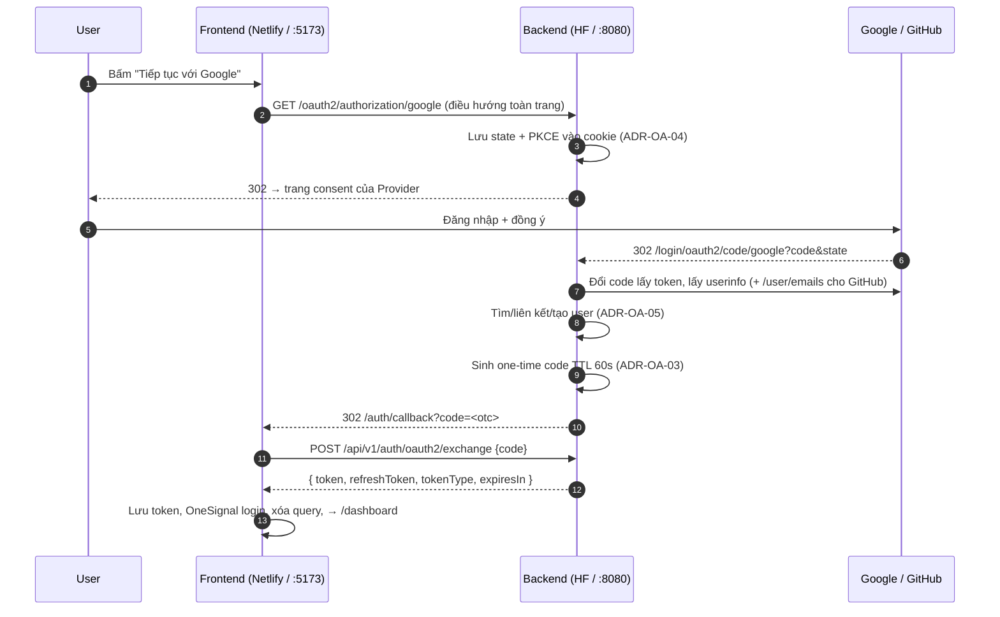

# PLAN — Security: OAuth2 & Social Login (Google, GitHub)

| Mục | Giá trị |
|---|---|
| Giai đoạn đề cương | Security: OAuth2 & Social Login — **15/11/2026 → 24/11/2026** |
| Kết quả mong đợi (đề cương) | Đăng nhập 1 chạm qua Google / GitHub mượt mà; xác thực đồng nhất với JWT nội bộ |
| Repo | `taskpilot` (backend), `taskpilot-frontend` |
| Quyết định kiến trúc | [DECISIONS.md](DECISIONS.md) |
| Tiêu chí chấp nhận | [ACCEPTANCE_CRITERIA.md](ACCEPTANCE_CRITERIA.md) |
| Kế hoạch kiểm thử | [TEST_PLAN.md](TEST_PLAN.md) |
| Kịch bản UAT | [UAT.md](UAT.md) |
| Theo dõi tiến độ | [STATUS.md](STATUS.md) |
| Skill / Workflow | `.agents/skills/taskpilot-oauth2-social-login/` |

---

## 1. Mục tiêu & Phạm vi

### Trong phạm vi
1. Đăng nhập / đăng ký 1 chạm qua **Google (OIDC)** và **GitHub (OAuth2)**.
2. Đồng bộ thông tin user (email, tên, avatar) và **liên kết tự động** với tài khoản email/password đã có (email đã xác minh).
3. Phát hành **JWT nội bộ + refresh token** như luồng login hiện tại.
4. Frontend: nút social trên Login/Register, trang `/auth/callback`, i18n vi/en, 3 theme, mobile.
5. Phân quyền: user mới qua social = `USER`; user liên kết giữ nguyên role/project role.

### Ngoài phạm vi
- Authentik / Keycloak / IdP riêng (xem ADR-OA-01).
- Hủy liên kết (unlink) provider trên UI, quản lý identity trong Admin (ghi vào backlog).
- MFA, SAML, đăng nhập Microsoft/Apple.

---

## 2. Kiến trúc luồng

Lỗi ở bất kỳ bước nào → `302 /auth/callback?error=<code>` (ADR-OA-08).

---

## 3. Work Breakdown (task ID dùng chung với STATUS.md)

### Phase 0 — Chuẩn bị (0.5 ngày)
| ID | Task | Đầu ra |
|---|---|---|
| T0.1 | Kiểm tra env: 5 biến có trong `taskpilot/.env` và HF Secrets (không in giá trị) | Checklist pass |
| T0.2 | Đồng bộ nhánh: commit/stash thay đổi đang dở trên `fix/s1-stabilize`, tạo `feat/oauth2-social-login` từ `main` mới nhất (BE + FE) | Branch sạch |
| T0.3 | Xác định version Flyway kế tiếp **trên nhánh đích** (checkout hiện tại tới V34, báo cáo GĐ5 nhắc V40) → chốt `V{N+1}` | Ghi vào STATUS.md |
| T0.4 | Xác nhận redirect URI trên Google Console (8080, 7860, HF) và 2 GitHub App | Ảnh chụp cho báo cáo |

### Phase 1 — Database & Domain (0.5 ngày)
| ID | Task | File chính |
|---|---|---|
| T1.1 | Migration `V{N+1}__oauth2_user_identities.sql`: `ALTER users.password_hash DROP NOT NULL`; tạo `user_identities` + `UNIQUE(provider, provider_subject)` + index `user_id`; enum/varchar `auth_provider ∈ {GOOGLE, GITHUB}` | `taskpilot-app/.../db/migration/` |
| T1.2 | Entity `UserIdentityEntity`, enum `AuthProvider`, `UserIdentityRepository` | `taskpilot-users/.../common/` |
| T1.3 | `UserEntity.password` cho phép null (`nullable = true`) | `UserEntity.java` |

### Phase 2 — Backend OAuth2 core (2 ngày)
| ID | Task | Ghi chú |
|---|---|---|
| T2.1 | Thêm `spring-boot-starter-oauth2-client` (`taskpilot-infrastructure`) | Không đổi version Boot 4.1.0 |
| T2.2 | Properties `application.security.oauth2.*` (google/github client-id/secret, success-redirect-uri, code-ttl) trong `application.yml`; `forward-headers-strategy: framework` trong `application-prod.yml` | ADR-OA-06, 09 |
| T2.3 | `ClientRegistrationRepository` có điều kiện (bỏ provider rỗng). Scope Google `openid,email,profile`; GitHub `read:user,user:email` | ADR-OA-06 |
| T2.4 | `HttpCookieOAuth2AuthorizationRequestRepository` | ADR-OA-04 |
| T2.5 | `OAuth2UserInfo` + mapper Google / GitHub (gọi `/user/emails` khi email null/private) | |
| T2.6 | `OAuth2AccountService.resolveUser(...)`: tra identity → liên kết email đã xác minh → tạo mới; cập nhật `last_login_at` | `@Transactional`, ADR-OA-05 |
| T2.7 | `OAuth2OneTimeCodeStore` (memory + redis, TTL 60s, consume nguyên tử) | ADR-OA-03 |
| T2.8 | `OAuth2LoginSuccessHandler` / `OAuth2LoginFailureHandler` | ADR-OA-03, 08 |
| T2.9 | `SecurityConfig`: `oauth2Login(...)`, permit `/oauth2/**`, `/login/oauth2/**`, `/api/v1/auth/oauth2/**`; giữ JSON entry point | ADR-OA-07 |
| T2.10 | `AuthController`: `POST /api/v1/auth/oauth2/exchange`, `GET /api/v1/auth/oauth2/providers` (+ Swagger) | `@SecurityRequirements()` |

### Phase 3 — Tương thích luồng cũ (0.5 ngày)
| ID | Task |
|---|---|
| T3.1 | `AuthService.login`: user có `password == null` → trả `401 Invalid email or password` (không NPE, không lộ thông tin) |
| T3.2 | `ProfileService.changePassword`: user chưa có mật khẩu → cho phép **đặt** mật khẩu (bỏ yêu cầu mật khẩu cũ); user có mật khẩu → giữ nguyên logic |
| T3.3 | `forgot/reset-password` hoạt động cho user social (cho phép tạo mật khẩu local) — chỉ xác nhận, không đổi code nếu không cần |
| T3.4 | `UserProfileResponse` thêm `hasPassword: boolean`, `linkedProviders: string[]` (để FE hiện "Đặt mật khẩu" thay vì "Đổi mật khẩu") |

### Phase 4 — Frontend (2 ngày)
| ID | Task | File chính |
|---|---|---|
| T4.1 | `auth.service.ts`: `getOAuthProviders()`, `exchangeOAuthCode(code)`; helper `buildOAuthAuthorizeUrl(provider)` từ `VITE_API_BASE_URL` (bỏ hậu tố `/api`) | `services/auth.service.ts` |
| T4.2 | `auth.store.ts`: `loginWithOAuthCode(code)` tái dùng `applyTokens` + OneSignal | `stores/auth.store.ts` |
| T4.3 | Component `SocialLoginButtons` (Google, GitHub; theo brand guideline; ẩn provider bị tắt; trạng thái loading) | `components/auth/` |
| T4.4 | Gắn vào `LoginPage` và `RegisterPage` (divider "hoặc") | `pages/` |
| T4.5 | `AuthCallbackPage` route `/auth/callback`: đọc `code`/`error`, **chống gọi 2 lần (StrictMode, code dùng 1 lần)**, `history.replaceState` xóa query, điều hướng `/dashboard` hoặc `/login` + toast lỗi | `pages/`, `routes/router.tsx` |
| T4.6 | Profile: hiện provider đã liên kết, "Đặt mật khẩu" khi `hasPassword=false` | `pages/Profile…` |
| T4.7 | i18n `auth.oauth.*` vi/en đầy đủ (parity 100%) | `locales/vi.json`, `en.json` |

### Phase 5 — Kiểm thử & Nghiệm thu (1.5 ngày)
| ID | Task |
|---|---|
| T5.1 | Unit/integration test backend — [TEST_PLAN.md §2](TEST_PLAN.md) |
| T5.2 | Vitest frontend — [TEST_PLAN.md §3](TEST_PLAN.md) |
| T5.3 | Playwright `e2e/09-oauth2-callback.spec.ts` (mock exchange) |
| T5.4 | Skills chất lượng: `i18n-checker`, `anti-ai-ui`, `mobile-responsive-test` |
| T5.5 | UAT thủ công local — [UAT.md](UAT.md) (chụp ảnh) |

### Phase 6 — Deploy & Nghiệm thu prod (0.5 ngày)
| ID | Task |
|---|---|
| T6.1 | `hf-deploy-verifier` (build Java 25, Docker, port 7860) |
| T6.2 | Deploy BE (HF) + FE (Netlify), UAT prod các case U-13, U-14 |

### Phase 7–8 — Tài liệu & Báo cáo (0.5 ngày)
| ID | Task |
|---|---|
| T8.1 | Cập nhật `STATUS.md`, `progress-tracker` (log kỳ + `PROGRESS_INDEX.md`) |
| T8.2 | Sửa tài liệu cũ nhắc Authentik: `PROGRESS_INDEX.md` Đợt 06, `report/src/chapter2/authentik.typ` → chương Spring Security OAuth2 / OIDC |
| T8.3 | Sequence diagram OAuth2 cho báo cáo (`report/src/assets/sync-diagrams/sequence/sequence-auth-oauth2-social-login.mmd`) |

---

## 4. Lịch dự kiến (8 ngày làm việc trong khung 15/11 – 24/11)

| Ngày | Phase | Gate |
|---|---|---|
| D1 (15/11) | P0 + P1 | Migration chạy sạch trên DB dev |
| D2–D3 | P2 | Login Google/GitHub tới được success handler (log), TC-BE pass |
| D4 | P3 | Hồi quy luồng email/password xanh |
| D5–D6 | P4 | Luồng end-to-end local chạy được |
| D7 | P5 | 100% AC "Must" pass, UAT local xong |
| D8 (24/11) | P6 + P8 | Prod pass, báo cáo cập nhật |

---

## 5. Rủi ro & Phòng ngừa

| Rủi ro | Mức | Phòng ngừa |
|---|---|---|
| `redirect_uri_mismatch` trên prod do proxy HF | Cao | ADR-OA-09, test U-13 |
| `authorization_request_not_found` do STATELESS | Cao | ADR-OA-04 |
| API trả 302 thay vì 401 sau khi bật oauth2Login | Cao | ADR-OA-07, TC-BE-SEC-01 |
| Chiếm tài khoản qua email chưa xác minh | Cao | ADR-OA-05, TC-BE-ACC-04/05 |
| GitHub email private → không có email | Trung bình | `/user/emails`, U-04 |
| React StrictMode gọi exchange 2 lần → lần 2 lỗi | Trung bình | `useRef` guard, TC-FE-04 |
| App không khởi động khi thiếu secret (CI) | Trung bình | ADR-OA-06, TC-BE-CFG-01 |
| Google app ở chế độ Testing chặn email lạ | Thấp | Thêm Test users hoặc Publish |
| Flyway version trùng giữa nhánh | Trung bình | T0.3 |

---

## 6. Definition of Done
- [ ] Mọi AC mức **Must** trong ACCEPTANCE_CRITERIA.md: PASS
- [ ] `mvnw test` toàn reactor BUILD SUCCESS; `npm run test`, `npm run build`, `npm run lint` pass
- [ ] i18n parity 100%; UI pass 3 theme + mobile 375×812
- [ ] UAT local + prod có ảnh minh chứng trong `report/src/assets/auth-oauth2/`
- [ ] Không secret nào bị commit (`git grep` các tiền tố `GOCSPX-`, `ghp_`, client secret)
- [ ] STATUS.md, progress-tracker, tài liệu Authentik cũ đã cập nhật
