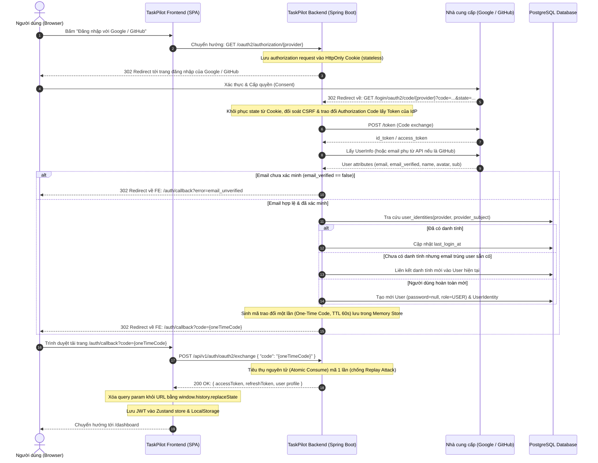
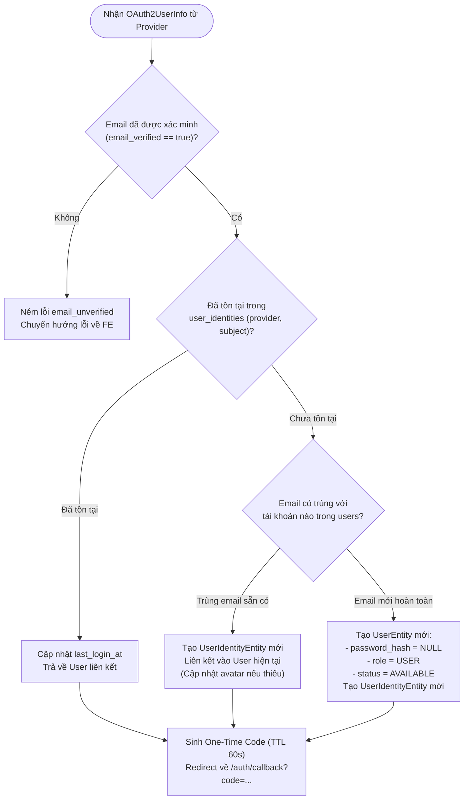

# Sơ đồ Tuần tự (Sequence Diagram) — OAuth2 & Social Login (Google & GitHub)

Tài liệu thiết kế kiến trúc và tuần tự dành cho báo cáo chuyên đề và Khóa luận Tốt nghiệp.

---

## 1. Kiến trúc Tổng thể Luồng Xác thực OAuth2 qua Single-Use One-Time Code

Quy trình xác thực tuân thủ khuyến nghị bảo mật OAuth 2.0 Security Best Current Practice (BCP) của IETF: **Không truyền trực tiếp Access Token / JWT qua URL / Query parameters**. Thay vào đó, Backend trả về một mã trao đổi dùng 1 lần (One-Time Code, TTL 60s) để Frontend tiêu thụ thông qua POST payload an toàn.

---

## 2. Chi tiết Luồng Phân giải & Liên kết Tài khoản (Account Resolution Matrix)

---

## 3. Đặc tả An toàn Bảo mật (Security Invariants)

1. **Không lộ Secret**:
   - Client Secret của Google & GitHub nằm hoàn toàn ở Backend (`taskpilot/.env`), không bao giờ chuyển xuống Frontend hay Git.
2. **Bảo vệ Token trên URL**:
   - Sử dụng One-Time Exchange Code (TTL 60s, Single-Use). Ngay cả khi URL bị lưu vào Browser History, mã đã bị tiêu thụ và vô hiệu hóa ngay lập tức.
3. **Chống giả mạo Email (Account Takeover Protection)**:
   - Chỉ tự động liên kết tài khoản khi và chỉ khi email được nhà cung cấp chứng nhận `email_verified == true`. Đối với GitHub nếu email để private, hệ thống truy vấn endpoint bảo mật `https://api.github.com/user/emails` và chỉ chấp nhận email có `verified: true, primary: true`.
4. **Hỗ trợ người dùng không có mật khẩu (Password-less Social Users)**:
   - Cột `users.password_hash` được chuyển thành nullable.
   - Endpoint `POST /api/v1/auth/login` kiểm tra null an toàn, trả về lỗi nghiệp vụ Bad Credentials thay vì sập hệ thống (NPE).
   - Trang Profile cung cấp giao diện "Thiết lập mật khẩu" (không đòi hỏi mật khẩu cũ) cho người dùng đăng nhập lần đầu qua Google/GitHub muốn bổ sung mật khẩu để đăng nhập trực tiếp bằng email.
